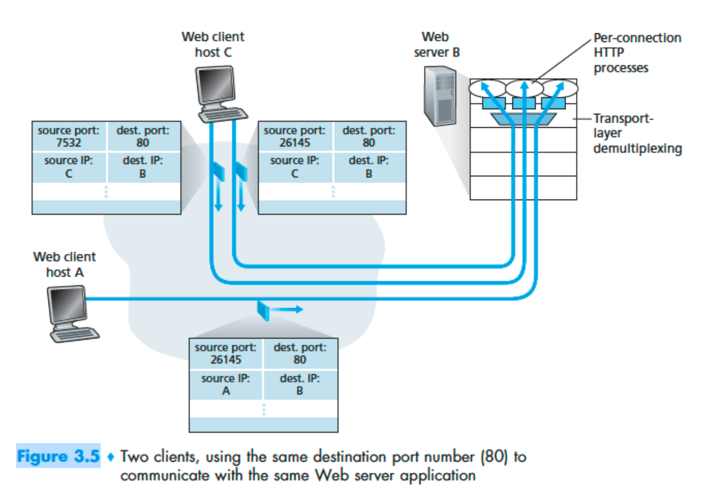
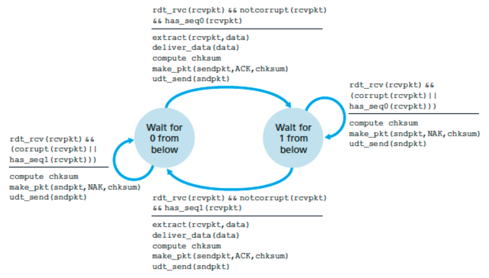
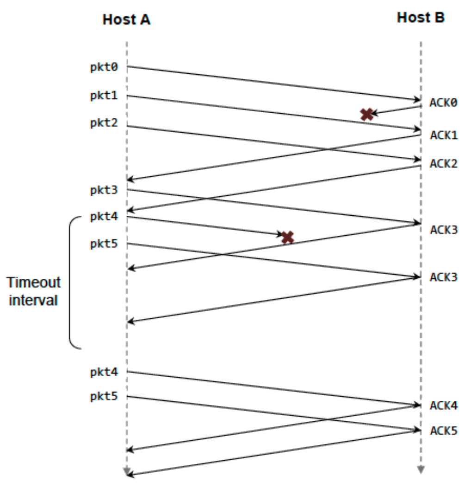
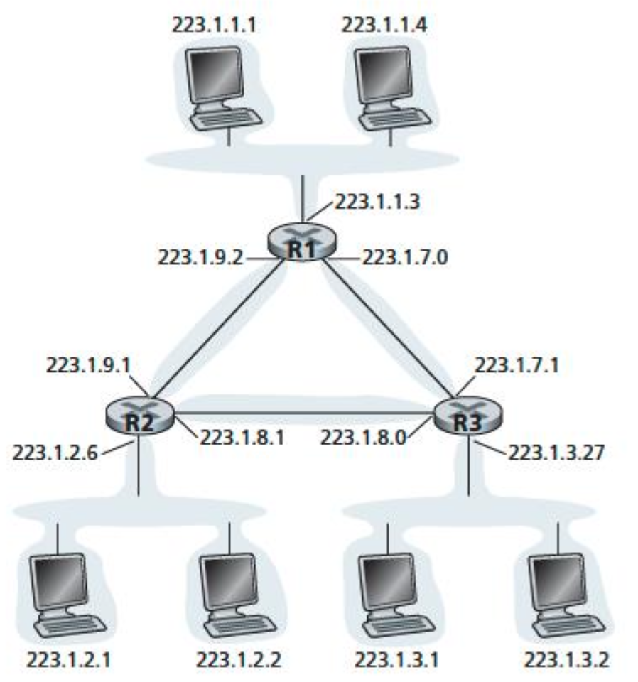
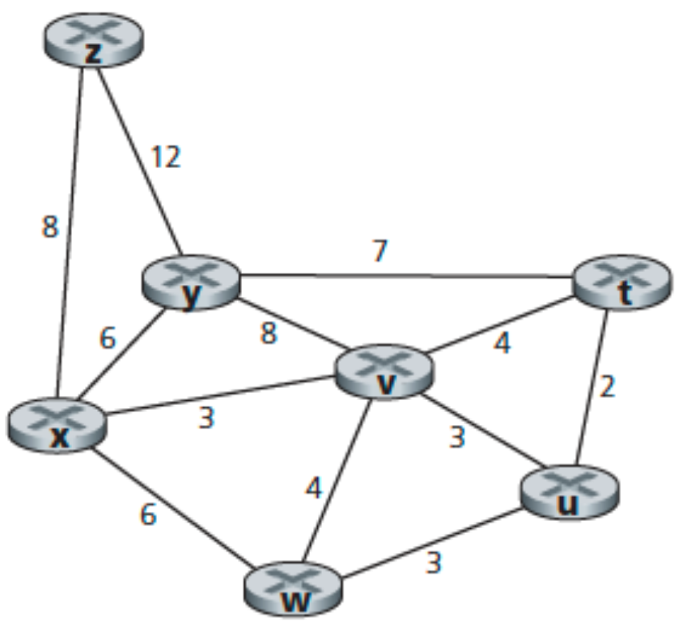

# IT 511: Sorular ve Yanıtlar

## Soru 1

Sunucudan istemci süreçlerine dönen segmentlerin kaynak ve hedef portları ile bu segmentleri taşıyan ağ katmanı datagramlarının IP adresleri nelerdir?



### Yanıt 1

| İletişim | Kaynak port | Kaynak IP | Hedef port | Hedef IP |
| --- | ---: | --- | ---: | --- |
| A → Sunucu | 26145 | a | 80 | b |
| Sunucu → A | 80 | b | 26145 | a |
| C (sol süreç) → Sunucu | 7532 | c | 80 | b |
| Sunucu → C (sol süreç) | 80 | b | 7532 | c |
| C (sağ süreç) → Sunucu | 26145 | c | 80 | b |
| Sunucu → C (sağ süreç) | 80 | b | 26145 | c |

C ana bilgisayarındaki iki süreç aynı sunucunun 80 numaralı portuyla iletişim kurar. İşletim sistemi, gelen segmentlerin hedef portlarına (26145 veya 7532) bakarak doğru sokete ve sürece teslim eder.

## Soru 2

UDP ve TCP sağlama toplamında 1'lerin tümleyeni kullanır. 8 bitlik `01010011`, `01100110` ve `01110100` baytlarının toplamının 1'ler tümleyenini bulun ve işlemi gösterin. Neden toplamın kendisi değil, tümleyeni kullanılır? Alıcı hatayı nasıl saptar? Bir bitlik veya iki bitlik hata saptanamayabilir mi?

### Yanıt 2

```text
  01010011
+ 01100110
  --------
  10111001

  10111001
+ 01110100
  --------
  00101110   (8. bitten taşan 1 başa eklenir)

1'ler tümleyeni: 11010001
```

Alıcı üç veri sözcüğünü sağlama toplamıyla birlikte toplar ve sonuç tüm bitleri 1 değilse hata olduğunu anlar. Bu yöntem tüm tek bitlik hataları yakalar; bazı iki bitlik hata örüntüleri birbirini dengeleyerek saptanmayabilir.

## Soru 3

rdt3.0'da alıcıdan göndericiye giden ACK paketlerinde neden ayrıca sıra numarası yoktur? ACK'nin onayladığı paket numarası zaten ACK alanında bulunur.

### Yanıt 3

Veri paketlerinde sıra numarası, yinelenen paketi tanımak için gereklidir. Gönderici, beklediği ACK numarasını zaten bilir; yinelenen ya da beklenmeyen ACK doğru durumda olmadığından yok sayılır. ACK'nin kendi sıra numarasına ihtiyaç yoktur.



## Soru 4

Paket kaybı yaşanabilen, ancak en büyük gecikmesi bilinen bir kanalda rdt2.1'e zaman aşımı ve yeniden gönderim ekleyin. Protokolün doğru iletişim kuracağını açıklayın.

### Yanıt 4

Gönderici her paket için zamanlayıcı başlatır. Doğru ACK zaman aşımı dolmadan ulaşmazsa gönderici paketi yeniden yollar. Sıra numaraları alıcının yinelenen veriyi saptamasını sağlar; alıcı veriyi uygulamaya ikinci kez teslim etmeden uygun ACK'yi yeniden gönderir. Bilinen azami gecikmeye uygun bir zaman aşımı seçildiğinde kayıp veya bozulma sonsuz beklemeye yol açmaz.

## Soru 5

A ve B, pencere boyutu N=3 olan GBN kullanıyor. A altı ileti gönderiyor; ilk ACK ile beşinci veri segmenti kayboluyor. Tüm iletiler sonunda doğru ulaştığında segment ve ACK sıra numaralarını gösterin.

### Yanıt 5



## Soru 6

A, B'ye L baytlık çok büyük bir dosya gönderiyor. MSS 536 bayt. (a) TCP'nin 4 baytlık sıra numarası alanı tükenmeden gönderilebilecek en büyük L nedir? (b) Her segmente toplam 66 bayt başlık eklendiğinde, 155 Mbps bağlantıda aktarım ne kadar sürer? Akış ve tıkanıklık denetimini yok sayın.

### Yanıt 6

TCP sıra numarası baytlar üzerinden ilerler; dolayısıyla üst sınır `2^32 = 4,294,967,296` bayttır (yaklaşık 4.29 GB; ikili ölçekte 4 GiB). MSS başına yaklaşık 66 bayt başlık varsayıldığında yaklaşık 8,012,999 segment oluşur ve başlıklar yaklaşık 528,857,934 bayt ekler. Toplam aktarım yaklaşık `4.824 × 10^9` bayttır. 155 Mbps hızda süre yaklaşık **249 saniyedir**.

## Soru 7

GBN, Selective Repeat (SR) ve gecikmeli ACK kullanmayan TCP'yi karşılaştırın. A beş segment gönderiyor ve ikinci segment kayboluyor; sonunda tümü B'ye ulaşıyor. Her protokolde toplam segment ve ACK sayılarını verin. Zaman aşımı 5 RTT'den çok uzunsa en hızlı protokol hangisidir?

### Yanıt 7

- **GBN:** A toplam 9 segment yollar: ilk 1–5, ardından 2–5 yeniden gönderilir. B toplam 8 ACK yollar: dört yinelenen ACK 1 ve ardından 2, 3, 4, 5 ACK'leri.
- **SR:** A toplam 6 segment yollar; yalnızca 2 yeniden gönderilir. B toplam 5 ACK yollar; başlangıçta 1, 3, 4, 5 için ve daha sonra 2 için ACK.
- **TCP:** A toplam 6 segment yollar; 2 yeniden gönderilir. B dört ACK 2 ve bir ACK 6 yollar; TCP bir sonraki beklenen baytı onaylar.

En kısa sürede tamamlayan **TCP**'dir; yinelenen ACK'lerden sonra hızlı yeniden iletim yaparak zaman aşımını beklemez.

## Soru 8

32 bit hedef adresleri kullanan yönlendiricide dört çıkış arabirimi vardır. Verilen adres aralıklarını beş girdili, en uzun önek eşleştirmeli iletme tablosuyla karşılayın; ardından üç hedef adresin arabirimini bulun.

### Yanıt 8

| Önek | Arabirim |
| --- | ---: |
| `11100000 00000000` | 0 |
| `11100000 00000001` | 1 |
| `1110000` | 2 |
| `11100010` | 3 |
| Diğer | 3 |

- `11111000 10010001 01010001 01010101` → 5. girdi, arabirim **3**.
- `11100000 00000000 11000011 00111100` → 1. girdi, arabirim **0**.
- `11100001 10000000 00010001 01110111` → 3. girdi, arabirim **2**.

## Soru 9

Üç uç ağ ve üç yönlendiriciler arası alt ağ için `214.97.254/23` bloğundan adres ayırın. A alt ağı 250, B ve C alt ağları 120 arayüz desteklemeli; D, E ve F en az ikişer arayüz desteklemelidir. Her yönlendirici için en uzun önek eşleştirmeli iletme tablolarını oluşturun.



### Yanıt 9

Örnek bir adresleme:

- A: `214.97.255.0/24` (256 adres)
- B: `214.97.254.0/25` içinden `214.97.254.0/29` çıkarılarak 120 adres
- C: `214.97.254.128/25` (128 adres)
- D: `214.97.254.0/31`, E: `214.97.254.2/31`, F: `214.97.254.4/30`

Yönlendirici tabloları, topolojide hangi iç bağlantının D, E ve F olduğuna göre en uzun eşleşen öneki ilgili alt ağa yönlendirir. Örnek çözümde tablolar ve topoloji [yanıt görselinde](assets/answer_9_1.png) gösterilmiştir.

## Soru 10

Verilen bağlantı maliyetleriyle Dijkstra algoritmasını kullanarak x düğümünden diğer düğümlere en kısa yolları bulun ve algoritma tablosunu oluşturun.



### Yanıt 10

| Adım | N' | D(t), p(t) | D(u), p(u) | D(v), p(v) | D(w), p(w) | D(y), p(y) | D(z), p(z) |
| ---: | --- | --- | --- | --- | --- | --- | --- |
| 0 | x | ∞ | ∞ | 3, x | 6, x | 6, x | 8, x |
| 1 | xv | 7, v | 6, v | 3, x | 6, x | 6, x | 8, x |
| 2 | xvu | 7, v | 6, v | 3, x | 6, x | 6, x | 8, x |
| 3 | xvuw | 7, v | 6, v | 3, x | 6, x | 6, x | 8, x |
| 4 | xvuwy | 7, v | 6, v | 3, x | 6, x | 6, x | 8, x |
| 5 | xvuwyt | 7, v | 6, v | 3, x | 6, x | 6, x | 8, x |
| 6 | xvuwytz | 7, v | 6, v | 3, x | 6, x | 6, x | 8, x |
