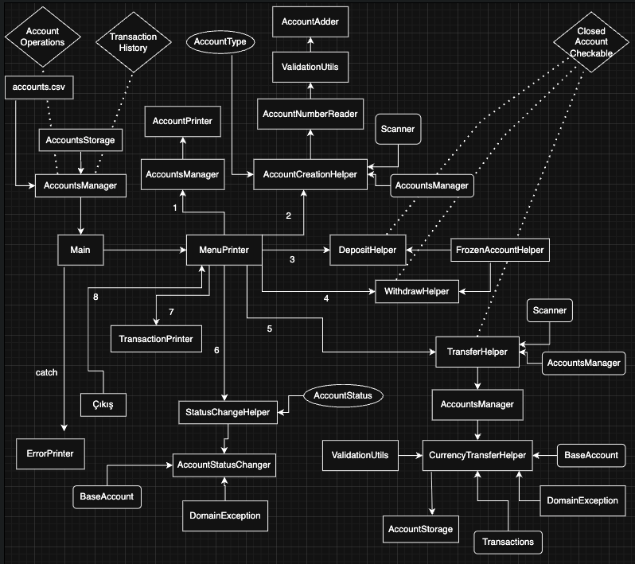

# TrueBank Java Banka Hesabı Uygulaması

## Proje hakkında

Java ile yazılmış bu temel banka hesabı yönetim uygulaması; hesap açma, para yatırma, para çekme, hesaplar arası transfer ve işlem geçmişini görüntüleme işlevlerini destekler. Uygulama konsoldan kullanılabilir; istenirse web arayüzüyle genişletilebilir.

> **Kaynak kodu ve uygulama:** Java kaynak kodu, derlenmiş sınıflar ve test verileri [TrueBank GitHub klasöründe](https://github.com/theomerkaratas/sabanci-university-information-technology-master-degree/tree/main/IT524/BankAccountProject) bulunur.

## Sistem mimarisi ve sınıf hiyerarşisi

Uygulama birden çok para birimiyle çalışan perakende bankacılık alanını modeller. Hesap durumunun kapsüllenmesi, işlem değişmezleri ve kalıcılık yönetimi ayrı hizmet ve model sınırlarına ayrılmıştır.

## Temel işlevler

- **Hesap yaşam döngüsü:** Benzersiz hesap kimlikleriyle hesap açma, kapatma, dondurma ve durum geçişleri.
- **İşlem altyapısı:** Güncel kur dönüşümüyle para yatırma, çekme ve farklı para birimleri arasında transfer.
- **Denetlenebilirlik ve geçmiş:** Hesap başına bütün finansal hareketlerin kaydı ve tarih sırasıyla görüntülenmesi.
- **Savunmacı doğrulama:** Bakiye yeterliliği denetimi, negatif tutarların reddi ve biçim doğrulaması.

## Geliştiriciler

- [Ömer Karataş](https://www.linkedin.com/in/theomerkaratas/)
- [Erkin Mahmatlı](https://www.linkedin.com/in/erkin-mahmatli-a201bb19b/)
- [Onur Vatandaş](https://www.linkedin.com/in/onurvatandas/)
