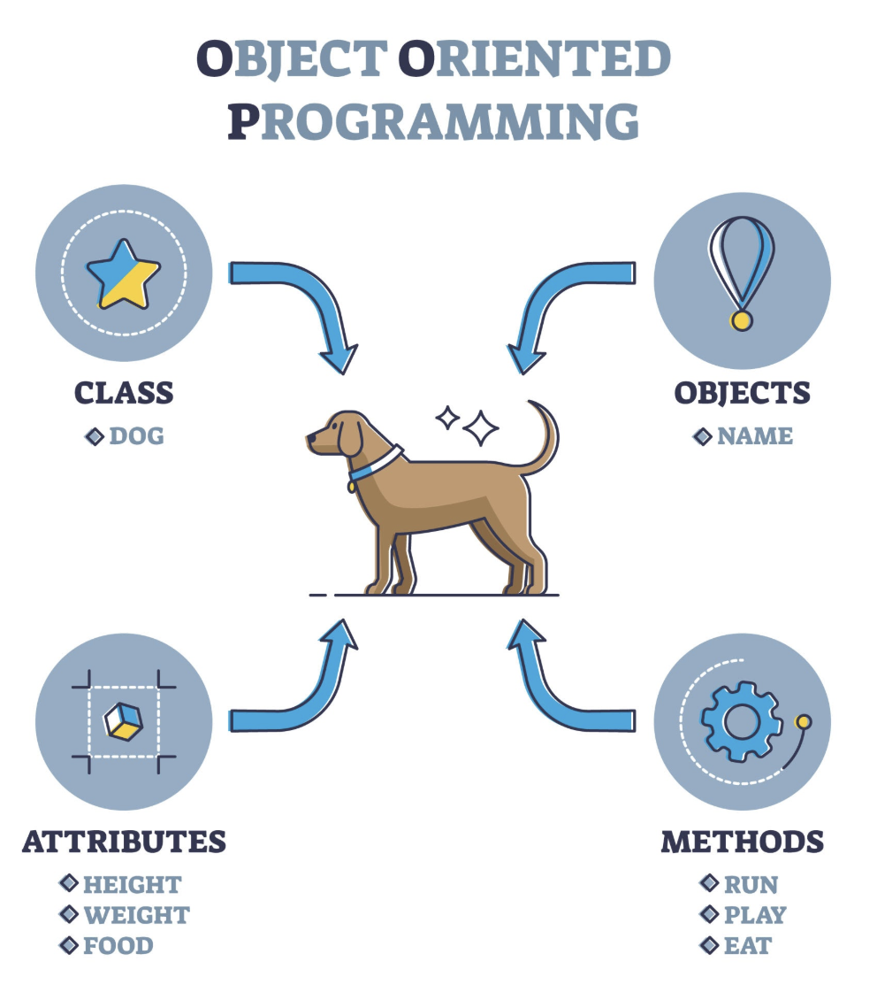
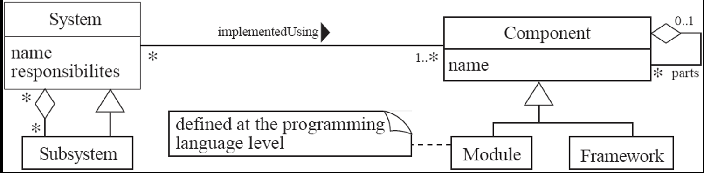
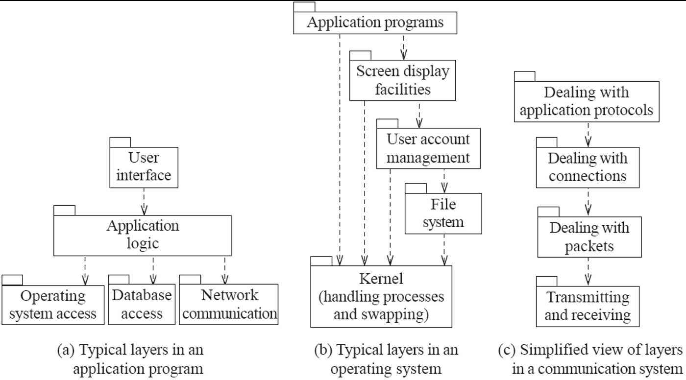
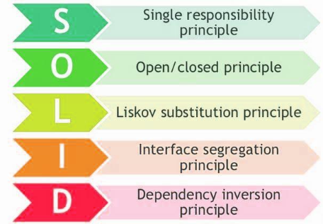

# IT 524: Java ile Nesne Yönelimli Programlama — Ders Notları

Bu sayfa, ders notlarının beş bölümündeki ana kavramları Türkçe olarak bir araya getirir: yazılımın doğası ve mühendisliği, nesne yönelimli programlama, yazılım tasarımı, nesne yönelimli tasarım ilkeleri ve temiz kod. İngilizce ana notlarda açıklamalar, kod örnekleri ve ek şekiller daha ayrıntılıdır.

## Bölüm 1: Yazılımın doğası ve yazılım mühendisliği

### Yazılım nedir?

Yazılım; program kodundan ibaret değildir. Programın çalıştırılması için gereken yapılandırma, veri, arayüz, kullanıcı ve teknik dokümantasyon da yazılım ürününün parçasıdır. Yazılım fiziksel olarak eskimez; ancak gereksinimler, işletim sistemleri, donanım, bağımlılıklar ve kullanıcı beklentileri değiştikçe bakım ve uyarlama ister.

Yaygın ürün türleri:

- **Genel amaçlı/ürün yazılımı:** Bir üretici tarafından geniş bir müşteri grubuna sunulur; ürün yol haritası üretici tarafından belirlenir.
- **Özel sipariş yazılımı:** Belirli bir müşteri için geliştirilir; gereksinim ve değişiklik kararlarında müşteri daha doğrudan rol alır.
- Pek çok gerçek sistem bu iki modelin özelliklerini bir arada taşır.

### Yazılım krizi

Yazılım sistemlerinin boyutu ve karmaşıklığı arttıkça projeler bütçeyi aşabilir, gecikebilir, güvenilmez olabilir veya kullanıcı ihtiyacını karşılamayabilir. Bunun nedenleri arasında gereksinimlerin belirsizliği, maliyet ve takvim tahminlerinin zorluğu, kötü iletişim, yetersiz test, kontrolsüz kapsam değişikliği ve bakım yükünün küçümsenmesi bulunur. Sorun yalnızca daha hızlı kod yazmakla çözülmez; planlama, tasarım, doğrulama ve iletişim de gereklidir.

### Yazılım mühendisliği ve paydaşlar

Yazılım mühendisliği, yazılımın belirtiminden tasarımına, geliştirilmesine, doğrulanmasına, dağıtımına ve evrimine sistematik biçimde yaklaşır. **Paydaşlar**; kullanıcılar, müşteriler, geliştiriciler, yöneticiler, işletim ve bakım ekipleri, düzenleyiciler ve sistemden etkilenen diğer taraflardır. Tasarım kararları bu grupların farklı hedef ve kısıtlarını dikkate almalıdır.

Yazılım kalitesi; işlevsellik, güvenilirlik, kullanılabilirlik, verimlilik, bakım yapılabilirlik ve taşınabilirlik gibi özelliklerden oluşur. **Kısa vadeli kalite** hızlıca çalışan özellikleri; **uzun vadeli kalite** değiştirilebilir, anlaşılır ve sürdürülebilir yapıyı da gözetir. Kısa vadeli teslimat uğruna tasarım ve test borcu biriktirmek gelecekteki değişiklikleri pahalılaştırır.

Yazılım mühendisliği projeleri yalnızca kodlamayı değil; gereksinimleri anlama, iş bölümü ve iletişimi, değişiklik yönetimini, kalite planını ve ürünü işletme/bakım faaliyetlerini içerir.

## Bölüm 2: Nesne yönelimli programlama temelleri

### Nesne, sınıf ve kurucu

**Nesne**, kimliği, durumu (alanlardaki değerler) ve davranışı (metotlar) olan çalışma zamanı öğesidir. **Sınıf**, aynı türden nesnelerin hangi veriye ve davranışa sahip olacağını belirleyen tanımdır. Nesne, sınıfın çalışma zamanı örneğidir. UML gösteriminde nesne, sınıfın adı ve varsa örnek değerleriyle gösterilir.

**Kurucu (constructor)** nesne oluşturulurken başlangıç durumunu kurar ve geçersiz nesne oluşmasını engellemelidir. Java'da kurucunun adı sınıfla aynıdır, dönüş tipi yoktur ve `new` ile çağrılır. Kurucu aşırı yükleme (overloading), farklı başlangıç parametreleri sunabilir. Alanları `private` tutmak ve doğrulanmış değerleri kontrollü metotlarla değiştirmek kapsüllemeyi korur.

### Türler ve erişim belirleyicileri

Java'da ilkel türler değerleri doğrudan taşır; sınıf türleri nesnelere başvuru (reference) taşır. Tür, hangi değerlerin ve işlemlerin geçerli olduğunu belirler. Erişim belirleyicileri üyelerin nereden kullanılacağını sınırlar:

- `public`: Her yerden erişilebilir.
- `protected`: Aynı paket ve alt sınıflardan erişilebilir.
- `private`: Yalnızca tanımlandığı sınıf içinde erişilebilir.
- Belirleyici yazılmaması: Paket kapsamı; aynı paketten erişim.

Veriyi gizlemek güvenlik ve bakım kolaylığı sağlar. İç durumun doğrudan değiştirilmesi yerine, değişmezleri denetleyen metotlar kullanılmalıdır.

### Alt sınıflama ve kalıtım

Kalıtım, alt sınıfın üst sınıftan alan ve davranış devralmasını sağlar. Alt sınıf uzmanlaştırılmış davranış ekleyebilir veya metot geçersiz kılabilir (override). Kalıtım “is-a” ilişkisini ifade etmelidir; yalnızca kodu kopyalamaktan kaçınmak için kullanılmamalıdır.

`super`, üst sınıfın kurucusunu veya üyesini çağırmaya yarar. Üst sınıf kurucusu alt sınıf kurucusunun başında `super(...)` ile çağrılır; açık çağrı yoksa uygun parametresiz kurucu aranır. Geçersiz kılma sırasında `super.method()` üst sınıf uygulamasını çağırır. Alanlar metotlar gibi polimorfik değildir; aynı isimli alt sınıf alanı üst sınıf alanını gölgeleme riski taşır.

### Soyut sınıflar ve arayüzler

**Soyut sınıf**, ortak alan veya uygulama paylaşırken bazı davranışları alt sınıflara bırakır. Soyut metotların gövdesi yoktur ve somut bir alt sınıfta uygulanmalıdır. Soyut sınıf doğrudan örneklenemez; eksik davranışları olan bir türden kullanılabilir nesne oluşturmak mümkün değildir. **Somut sınıf** ise gerekli davranışları tamamlamıştır ve örneklenebilir.

**Arayüz (interface)** bir sınıfın sağlayacağı davranış sözleşmesini tanımlar. Sınıflar birden fazla arayüzü uygulayabilir; Java'da bir sınıf yalnızca tek doğrudan sınıfı genişletir. Arayüzlere göre programlamak, kodun somut sınıfa bağımlılığını azaltır.

### OOP'nin temel özellikleri

- **Soyutlama:** Önemli davranışı dışarı açıp gereksiz uygulama ayrıntısını gizlemek.
- **Kapsülleme:** Durumla bu durumu koruyan işlemleri bir arada tutmak ve erişimi denetlemek.
- **Kalıtım:** Ortak davranışı üst türde toplayıp uzmanlaştırılmış alt türler oluşturmak.
- **Çok biçimlilik (polymorphism):** Üst tür veya arayüz üzerinden çağrılan metodun gerçek nesnenin türüne uygun davranması.

Yeniden kullanım, kalıtımla (is-a) veya bileşimle (has-a) sağlanabilir. Bileşim, nesneleri başka nesnelerle kurar; uygulama ve davranış değişimini çoğu zaman kalıtımdan daha esnek kılar.

## Bölüm 3: Yazılım tasarım süreci ve ilkeleri

### Tasarım bir kararlar dizisidir

Yazılım tasarımı, gereksinimleri bileşenlere, arayüzlere, veri yapılarına ve etkileşimlere dönüştüren kararlar bütünüdür. Her karar olası çözümlerden birini seçer; kalite nitelikleri ve kısıtlar arasında ödünleşim yaratabilir. Tasarım alanı (design space), bu olası çözümler ve özelliklerden oluşur. Kararları gereksinim, deneyim, prototip, analiz ve ekip tartışması yönlendirir.

### Yapısal yapı taşları

- **Bileşen:** Belirli hizmeti sunan, tanımlanmış arayüze sahip değiştirilebilir/yayılabilir birim.
- **Modül:** Kodu ve sorumluluğu bir arada tutan mantıksal bölüm.
- **Sistem:** Birlikte çalışan bileşenlerin bütünü.
- **Alt sistem:** Daha büyük sistem içinde kendi sorumluluk ve sınırına sahip bölüm.

**Yukarıdan aşağı tasarım**, sistemi üst düzey amaçtan alt bileşenlere doğru ayrıştırır. **Aşağıdan yukarı tasarım**, mevcut bileşenleri birleştirerek daha büyük yapılar kurar. Gerçek projelerde iki yaklaşım birlikte kullanılabilir. Tasarım yapısal mimariyi, veriyi, davranışı, kullanıcı arayüzünü, dağıtımı ve hata durumlarını ele alır.

### Temel tasarım ilkeleri

1. **Böl ve yönet:** Karmaşık sistemi daha küçük, anlaşılabilir sorumluluklara ayır.
2. **Uyumu artır (cohesion):** Bir modülün öğeleri aynı amaca hizmet etsin.
3. **Bağımlılığı azalt (coupling):** Modüller birbirlerinin iç ayrıntılarını bilmesin; açık arayüzlerle iletişim kursun.
4. **Soyutlama düzeyini yüksek tut:** Bir modülün istemcileri iç ayrıntıdan çok ne sunduğunu görsün.
5. **Yeniden kullanım için tasarla:** Gerçekten birden fazla kullanım varsa ortak davranışı iyi tanımlı bileşen haline getir.
6. **Mevcut tasarım ve koddan yararlan:** Uygun ve güvenilir çözümleri yeniden kullan; bağlam dışı kalıtım veya kopyala-yapıştır yapma.
7. **Esneklik sağla:** Beklenen değişimleri düşük maliyetle yapmaya izin ver; her olasılık için aşırı genelleme yapma.
8. **Eskimeyi öngör:** Harici hizmet, kütüphane ve teknolojilerin değişebileceğini hesaba kat.
9. **Taşınabilirlik:** Platforma özgü kodu sınırlayıp değişebilir sınırların arkasına al.
10. **Test edilebilirlik:** Bağımlılıkları açık, davranışı gözlenebilir ve bileşenleri izole edilebilir tasarla.
11. **Savunmacı tasarım:** Geçersiz girdiyi, hata durumunu ve yetkisiz kullanımı varsay; güvenli biçimde başarısız ol.

### Uyumluluk, bağımlılık ve soyutlama

Uyum türleri arasında en arzu edileni **işlevsel uyumdur**: modülün tüm parçaları tek, iyi tanımlı işi yapar. Katman uyumu aynı mimari katmana ait işleri; iletişimsel uyum ortak veri üzerinde çalışan işleri birleştirir. Ardışık ve yordam uyumu işlem sırası veya akışa bağlıdır. Zamansal uyum başlangıç/kapanışta birlikte yapılan işleri; yardımcı program uyumu ise ortak olmayan farklı yardımcı işlevleri bir araya getirebilir ve genellikle daha zayıftır.

Bağımlılık (coupling) düzeyleri kötüden iyileşene doğru değişir: **içerik bağımlılığı** başka modülün iç durumunu değiştirebilir; **ortak bağımlılık** global veri paylaşır; **denetim bağımlılığı** bir modüle diğerinin ne yapacağını bayraklarla söyler; **damga bağımlılığı** gereğinden fazla alan taşıyan nesne gönderir; **veri bağımlılığı** yalnız gereken değerleri aktarır. Çağrı, tür, import ve dış sistem bağımlılıkları da arayüzler ve katman sınırlarıyla yönetilmelidir.

Denetim bayrağıyla aynı metoda farklı iş yaptırmak yerine çok biçimlilik veya ayrı metotlar kullanılabilir. Katmanlı mimari, sorumlulukları ayırıp bir düzeydeki değişikliğin diğerine yayılmasını azaltır.

## Bölüm 4: Nesne yönelimli tasarım ilkeleri

- **KISS (Basit tut):** Gereksiz karmaşıklık ekleme.
- **DRY (Kendini tekrar etme):** Aynı iş kuralını birden çok yerde kopyalamak yerine tek kaynaktan yönet.
- **YAGNI (Henüz gerekmeyecek):** Gerçek gereksinim yokken varsayımsal özellik geliştirme.
- **Kaygıların ayrılması:** Farklı değişim nedenlerini ve sorumlulukları ayrı modüllerde tut.
- **Çalışan en basit çözüm:** Gereksinimi karşılayan küçük tasarımla başla.
- **Erken optimizasyon yapma:** Ölçmeden performans adına okunabilirliği bozma; önce darboğazı bul.
- **İzci kuralı:** Dokunduğun kodu küçük ölçüde daha temiz bırak.
- **Bağımlılığı azalt, uyumu artır:** Sınıfın tek ve anlaşılır amacı olsun.
- **Demeter Yasası:** Nesne, yakın işbirlikçilerinin arayüzünü kullanmalı; uzun nesne zincirleriyle iç yapıya bağlanmamalı.
- **Kalıtım yerine bileşim:** Davranışı çalışma zamanında birleştirmek gerekiyorsa bileşim tercih et.
- **Kontrolün tersine çevrilmesi (IoC):** Kontrol akışını veya bağımlılıkları üst düzey yapılandırmaya bırak; sınıf bağımlılığını dışarıdan sağla.
- **Uygulama ayrıntısını gizle:** Kullanıcılara kararlı arayüz sun, değişebilir iç tasarımı sakla.
- **Değişeni kapsülle:** Değişme olasılığı yüksek kararları dar bir sınırın arkasına al.
- **Curly ilkesi:** Birbirine benzeyen kavramları aynı adla, farklı kavramları farklı adlarla ifade et.
- **Artımlı geliştir ve değişime tasarla:** Küçük teslimatlarla öğren, değişim maliyetini makul tut.

Yeniden tasarım ihtiyacı çoğunlukla değişen gereksinimler, aşırı bağlı bileşenler, başta yanlış varsayılan mimari, kopyalanmış mantık ve büyüyen teknik borçtan doğar. Tasarım sürekli gözden geçirilmeli; ama sırf moda olduğu için baştan yazılmamalıdır.

## Bölüm 5: Temiz kod

### Anlamlı adlar

Adlar niyeti ve kullanım amacını açıklamalıdır. Yanıltıcı kısaltmalardan, yalnızca harf farkı taşıyan benzer adlardan ve aranması zor isimlerden kaçının. Sınıf adları çoğunlukla isim, metot adları eylem ifade eder. Arayüz ve uygulama isimleri ayırt edilebilir olmalı; bağlamı zaten belli olan sınıf adına gereksiz önek eklenmemelidir. Aynı işi yapan kavramlar aynı kelimeyle anılmalıdır.

### İşlevler

İşlevler küçük, tek sorumluluklu ve tek soyutlama düzeyinde olmalıdır. Bir işlevin “tek işi” varsa, aynı seviyedeki adımları bir bütün olarak açıklar. Bağımlı adımlar okunabilir bir yukarıdan aşağı akışla düzenlenebilir.

Çok sayıda argüman işlev çağrısını ve testini zorlaştırır. Birkaç ilişkili alan anlamlı bir argüman nesnesinde toplanabilir; gereksiz çıktı argümanlarından kaçının. Bayrak argümanı işlevin birden fazla iş yaptığını gösterebilir; bunun yerine ayrı ve adlandırılmış operasyonlar tercih edilir.

**Komut-sorgu ayrımı**, bir işlevin ya durumu değiştirmesini ya da bilgi döndürmesini, ikisini belirsizce birleştirmemesini önerir. Hata kodları yerine istisnalar kullanılabilir; hata işleme ana iş mantığını gölgelememelidir. Yan etkiler açık olmalı, `try/catch` blokları uygun sınırda ayrıştırılmalı, tekrar eden kod çıkarılmalıdır.

### Yorumlar

Yorumlar faydalı olabilir, fakat kod değişip yorum güncellenmediğinde yanıltıcı hale gelir. Önce niyeti açıklayan ad ve kod yapısı kullanın. İyi yorumlar yasal yükümlülük, güvenlik uyarısı, neden belirli kararın alındığı veya açık olmayan bir etkiyi anlatabilir. Kötü yorum örnekleri: yorum satırına alınmış eski kod, kodu aynen tekrar eden açıklama, günlüğe benzeyen tarihçe, gürültü ve gereksiz bölüm ayraçları. TODO notları sahip, bağlam ve takip olmadan kalıcılaşmamalıdır.

### Biçimlendirme

Dikey biçimlendirmede dosya bir gazete gibi okunabilir: önce genel amaç, ardından ayrıntılar. Birbirine yakın kavramlar yakın tutulmalı, ilgili işlevler arka arkaya sıralanmalı ve çağrılan yardımcı işlevler mantıklı akışta yer almalıdır. Yerel değişkenler kullanıldıkları yere yakın; örnek alanları sınıfın başında veya tutarlı bir düzen içinde tanımlanır.

Yatay biçimlendirmede satır uzunluğu yönetilebilir tutulmalı, boşluklar ifadeleri gruplamak için kullanılmalı ve girintileme kontrol akışını göstermelidir. Tutarlı biçim, kod gözden geçirmeyi ve hata ayıklamayı kolaylaştırır.

## SOLID ilkeleri

Bu dersin tasarım ve mimari başlıkları SOLID ilkeleriyle de ilişkilidir:

- **S — Tek Sorumluluk (SRP):** Bir sınıfın değişmesi için tek bir ana neden olsun.
- **O — Açık/Kapalı (OCP):** Davranış genişletilebilir, mevcut ve kararlı kod mümkün olduğunca değişmeden kalabilir olsun.
- **L — Liskov Yerine Geçme (LSP):** Alt tür, üst tür sözleşmesini bozmadan onun yerine kullanılabilsin.
- **I — Arayüz Ayrımı (ISP):** İstemciler kullanmadıkları metotlara bağımlı olmaya zorlanmasın.
- **D — Bağımlılığın Tersine Çevrilmesi (DIP):** Üst düzey politika somut ayrıntılara değil soyutlamalara bağımlı olsun.

