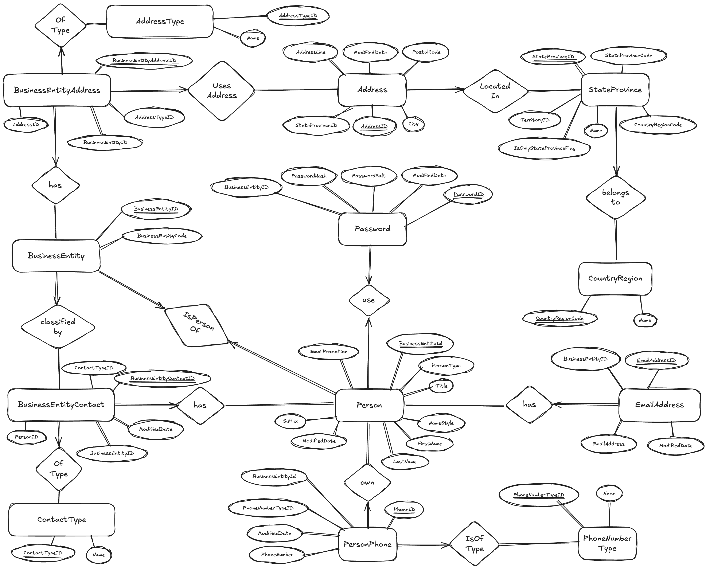

# IT 553: Veritabanı Tasarımı ve Yönetimi 🗄️📊

Bu derste ilişkisel veritabanı modelleme, normalizasyon, ACID işlem bütünlüğü, saklı yordamlar, tetikleyiciler ve kapsayıcılarla veritabanı yönetimi ele alınır.

> **SQL ve Docker dosyaları:** Şema betikleri, örnek veriler, tetikleyiciler ve kapsayıcı yapılandırmaları [IT553 GitHub klasöründedir](https://github.com/theomerkaratas/sabanci-university-information-technology-master-degree/tree/main/IT553).

## Tasarım hedefleri ve uygulamalar

- **Normalizasyon (3NF / BCNF):** Çok öznitelikli varlıklar, ekleme, güncelleme ve silme anomalilerini azaltacak biçimde ayrıştırılır.
- **Başvurulan bütünlük:** Tablolar arasında `ON DELETE CASCADE` ve `ON UPDATE CASCADE` kurallarıyla yabancı anahtar ilişkileri tanımlanır.
- **Veritabanı tetikleyicileri:** `BEFORE INSERT` tetikleyicileri e-posta, telefon ve posta kodu gibi alanları doğrular; geçersiz değerlerde `SQLSTATE '45000'` hatası üretir.
- **İki şema:** Kurumsal model için `person`, ilişkisel sorgu çalışmaları için `reservations_system` şemaları hazırlanır.
- **Kapsayıcı tabanlı ortam:** MySQL 8.0; CloudBeaver, phpMyAdmin ve PDO kullanan Apache/PHP arayüzüyle birlikte çalıştırılır.

## Varlık-ilişki modeli

Şemanın genel görünümü:

### `BusinessEntity` tasarım kalıbı

1. **Ortak varlık kökü:** `BusinessEntity`, kişi gibi kayıtlar için ortak ve benzersiz bir kimlik sağlar.
2. **Çoka çok adres ilişkisi:** `BusinessEntityAddress`, varlıkları `Address` kayıtlarına `AddressTypeID` ile bağlar.
3. **Coğrafi normalizasyon:** Adresler `StateProvince` ve `CountryRegion` tablolarına ayrılarak ülke ve eyalet bilgilerinin tekrarı azaltılır.
4. **Kimlik bilgilerinin ayrılması:** `PasswordSalt` ve `PasswordHash`, profil bilgilerinden ayrı bir `Password` tablosunda tutulur.

## Tetikleyiciler ve veri kuralları

Veri tutarlılığı, istemci uygulamadan bağımsız olarak MySQL katmanında da denetlenir.

### E-posta biçimi: `trg_validate_emailformat`

`EmailAddress` tablosuna eklemeden önce değerde `@` ve `.` bulunması denetlenir. Geçersiz adresler `SQLSTATE '45000'` ile reddedilir.

### Posta kodu uzunluğu: `postalcheck`

`Address` tablosuna eklenen posta kodunun tam beş karakter olması zorunlu tutulur; uzunluk uymadığında işlem hata ile durdurulur.

## Şema sözlüğü

### Kurumsal şema: `person`

| Tablo | Anahtarlar | Amaç |
| --- | --- | --- |
| `BusinessEntity` | PK: `BusinessEntityID` | Kurumsal varlıklar için ortak kimlik kökü. |
| `Person` | PK/FK: `BusinessEntityID` → `BusinessEntity` | Ad, soyad, kişi türü ve e-posta tercihleri. |
| `Password` | PK/FK: `BusinessEntityID` → `Person` | Tuz ve parola özeti. |
| `EmailAddress` | PK: `(BusinessEntityID, EmailAddressID)`; FK → `Person` | Kişi başına birden çok e-posta adresi. |
| `PersonPhone` | PK: `(BusinessEntityID, PhoneNumber, PhoneNumberTypeID)`; FK → `Person`, `PhoneNumberType` | Türü belirtilmiş telefon numaraları. |
| `PhoneNumberType` | PK: `PhoneNumberTypeID` | Mobil, ev ve iş gibi telefon türleri. |
| `Address` | PK: `AddressID`; FK → `StateProvince` | Sokak, şehir ve posta kodu bilgileri. |
| `AddressType` | PK: `AddressTypeID` | Fatura, teslimat ve ofis gibi adres türleri. |
| `BusinessEntityAddress` | Bileşik PK: `BusinessEntityID`, `AddressID`, `AddressTypeID`; FK → ilgili üç tablo | Varlık, adres ve adres türü arasındaki ilişki. |
| `StateProvince` | PK: `StateProvinceID`; FK → `CountryRegion` | Eyalet ve bölge bilgileri. |
| `CountryRegion` | PK: `CountryRegionCode` | ISO ülke kodları. |
| `ContactType` | PK: `ContactTypeID` | Kurumsal irtibat rollerinin sözlüğü. |
| `BusinessEntityContact` | Bileşik PK: `BusinessEntityID`, `PersonID`, `ContactTypeID`; FK → ilgili tablolar | Varlıkları sorumlu kişiler ve rollerle eşleştirir. |

### Sorgu kıyaslama şeması: `reservations_system`

Karmaşık SQL sorguları, çok tablolu birleşimler, ilişkisel cebir ve bağıntılı alt sorgular üzerinde çalışmak için klasik bir ilişkisel modeldir.

| Tablo | Anahtarlar | Açıklama |
| --- | --- | --- |
| `Sailors` | PK: `sid` | Yeterlilik puanı (1–10) ve yaş bilgisi bulunan denizciler. |
| `Boats` | PK: `bid` | Kimlik, model ve renk bilgisi bulunan tekneler. |
| `Reserves` | PK: `(sid, bid, date)`; FK → `Sailors.sid`, `Boats.bid` | Denizci, tekne ve tarih arasındaki rezervasyonlar. |

## Teknoloji yığını ve altyapı

| Bileşen | Teknoloji | Kullanım amacı |
| --- | --- | --- |
| İlişkisel veritabanı | MySQL 8.0 | InnoDB ACID işlemleri ve UTF-8 desteğiyle veri saklama. |
| Veri hazırlama | 23 SQL başlangıç betiği | Şema oluşturma ve örnek verileri kapsayıcı başlangıcında yükleme. |
| Yönetim arayüzleri | CloudBeaver, phpMyAdmin | Sorgu çalıştırma, şema inceleme ve yürütme planlarını görüntüleme. |
| Uygulama katmanı | Apache 2.4, PHP 8.2 (PDO) | Veritabanına programatik bağlantıyı gösteren hafif web arayüzü. |
