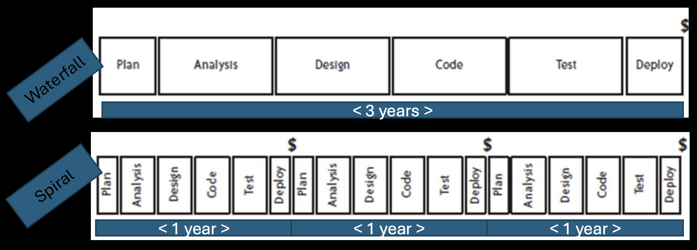
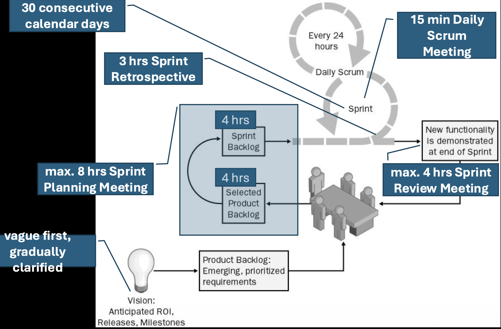
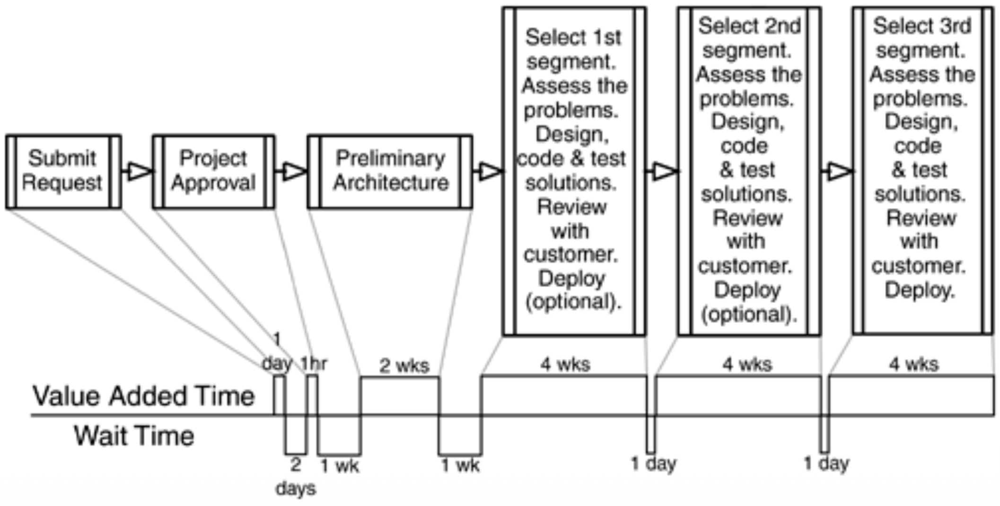
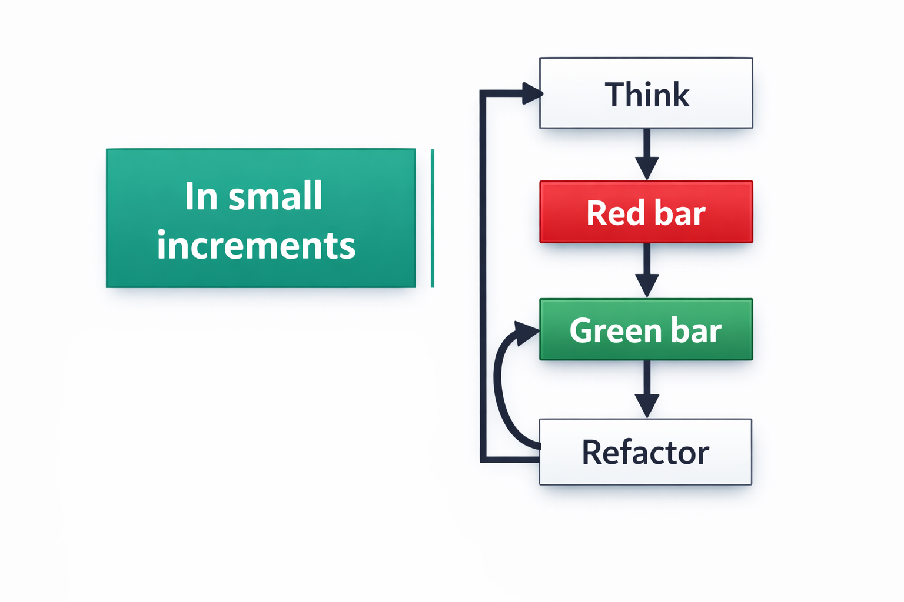
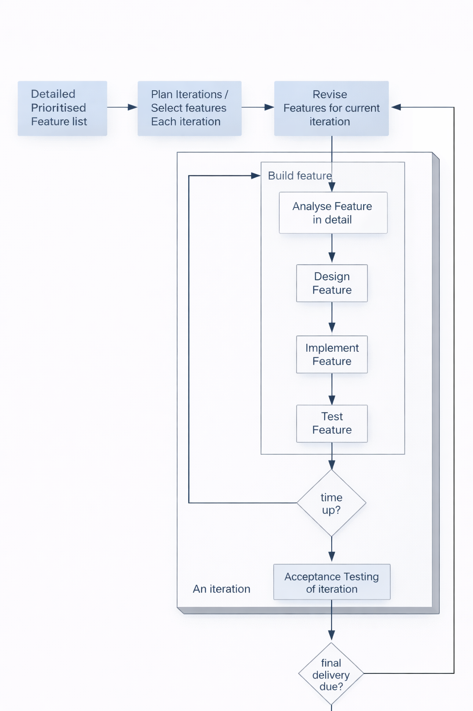

# IT 563: Çevik Proje Yönetimi Yöntemleri

Bu ders, yazılım projelerinde süreç seçimi ve iyileştirme, çevik değerler, Scrum, Yalın geliştirme, Extreme Programming (XP), Feature-Driven Development (FDD), yazılım testleri ve yalın girişim yaklaşımını inceler. Bu Türkçe sayfa, İngilizce ders notlarındaki ana konu ve kavramları daha ayrıntılı biçimde açıklar. Özgün notlardaki bütün örnekler ve ek görseller için [İngilizce IT563 ana sayfasına](README.md) bakabilirsiniz.

## Çevik yazılım geliştirmeye giriş

Çevik yazılım geliştirme tek bir reçete veya süreç değildir. Ortak değerleri paylaşan yöntem ve uygulamaların (Scrum ve XP gibi) oluşturduğu bir yaklaşımlar ailesidir. Çevik yaklaşım; müşteri ve iş uzmanlarıyla proje boyunca yakın çalışmayı, ekip içinde doğrudan iletişimi, küçük ve çalışan ürün parçalarının sık teslimini, kendi işini düzenleyen ekipleri ve teknik kaliteyi öne çıkarır.

Yazılım projelerinde ürünlerin büyüyüp karmaşıklaşması, sınırlı bütçe ve kısa pazara çıkış süresiyle çatışabilir. Ürünün kalitesi güvenilirlik, performans ve bakım kolaylığı gibi özelliklerle değerlendirilir. Test, kod ve tasarım incelemesi, kalite güvencesi, ölçüm, düzeltici eylem ve kusurların kök nedenini giderme bu nitelikleri destekler. Kaliteli bir süreç iyi ürün için güçlü bir etkendir ancak tek başına garanti değildir; insan, teknoloji, bütçe ve takvim de sonucu etkiler.

Süreç; kurumun boyutuna ve kültürüne, ekibin bilgi ve becerilerine, ürünün niteliğine ve pazar/müşteri gereksinimlerine göre uyarlanır. Her ortama uyan tek ve ideal bir süreç yoktur. Süreç iyileştirme döngüsü üç adımdan oluşur:

1. **Ölç:** Kusur oranı, çevrim süresi, teslimat sıklığı ve kullanılan kaynaklar gibi göstergeleri belirle.
2. **Analiz et:** Ölçümlerde darboğazları, zayıflıkları ve israfı ara.
3. **Değiştir:** Öncelikli sorunlara yönelik uygulamaları, sorumlulukları veya iş sırasını düzenle; sonuçları yeniden ölç.

Süreç ölçümü için önce sürecin ne olduğunun açıkça tanımlanması gerekir. Aksi halde ölçüm ve iyileştirme varsayıma dayanır. Değişiklik; yeni bir uygulama eklemek, etkinliklerin sırasını değiştirmek, gereksiz teslimatları kaldırmak veya yeni bir rol tanımlamak olabilir. Ekibin değişiklikleri anlaması için eğitim ve başlangıçta ince ayar da gerekebilir.

### Şelale, spiral ve çevik yaklaşım

- **Şelale modeli**, gereksinim analizi, tasarım, uygulama, test ve bakım adımlarını önceden planlanmış sıralı aşamalar olarak ele alır. Her aşama sonraki aşamaya belge veya başka bir çıktı bırakır. Gereksinimler iyi biliniyor ve büyük değişiklik beklenmiyorsa yönetimi kolay olabilir. Önceki aşamaya dönmek mümkün olsa da maliyetli bir istisna sayılır.
- **Spiral geliştirme**, belirtim, geliştirme ve doğrulamayı prototipler ve artımlarla iç içe yürütür. Her döngü önceki çıktıyı değerlendirip geri bildirim alır. Belirsiz gereksinimlerde yararlıdır; büyük projelerde kullanılabilir, ancak artımları destekleyecek bir mimariyi erkenden kurmayı gerektirebilir.
- **Çevik geliştirme**, plan odaklı süreçlerin değişen ve başta eksik olan gereksinimlere uyum sağlamakta zorlandığı durumlara yanıt verir. Kısa döngülerle çalışan ürün sunar, öğrenmeye göre yönünü ve önceliklerini günceller.

## Çevik Manifesto ve proje başarısı

Çevik Manifesto, yazılım geliştirirken şu değerlere daha fazla önem verir:

1. Süreçler ve araçlardan çok **bireyler ve etkileşimler**.
2. Kapsamlı dokümantasyondan çok **çalışan yazılım**.
3. Sözleşme müzakeresinden çok **müşteriyle iş birliği**.
4. Bir plana bağlı kalmaktan çok **değişime yanıt vermek**.

Sağdaki unsurların değeri vardır; soldakiler daha önceliklidir. Manifesto ilkeleri arasında müşteriyi erken ve sürekli değer teslim ederek memnun etmek, değişen gereksinimleri geç aşamada bile karşılamak, çalışan yazılımı haftalar veya aylar arayla sunmak, iş insanlarıyla geliştiricilerin her gün birlikte çalışması, motive ekiplere güvenmek, sürdürülebilir tempoda çalışmak, teknik mükemmelliğe ve iyi tasarıma sürekli dikkat etmek, sadeliği korumak ve düzenli olarak iyileştirme fırsatlarını değerlendirmek bulunur.

Proje başarısı yalnızca takvime, bütçeye ve ilk şartnameye uymakla ölçülmez. **Kurumsal başarı** iş değerini, müşteri memnuniyetini, erken ve sık teslimatı, değişen önceliklere uyumu ve israfın azaltılmasını kapsar. **Teknik başarı** iyi tasarım, test, eşli programlama, sürekli tümleştirme ve sürdürülebilir kodla ilgilidir. **Kişisel başarı** ekip memnuniyeti, öğrenme, özerklik ve faydalı ürün çıkarma gururunu içerir. Başarılı proje bu boyutların tümünde değer üretir.

## Scrum

Scrum, belirsiz ve karmaşık ürün geliştirmeyi küçük çevrimlerle yönetmeye yarayan çevik bir çerçevedir. Ayrıntılı ve değişmez bir başlangıç planı yerine deneysel süreç denetimine dayanır. Bunun üç dayanağı şunlardır:

- **Şeffaflık:** Sürecin ve ürünün önemli yönleri işi yapanlarca ve sonucu değerlendirenlerce görülebilir olmalı.
- **Denetleme:** Ürün artımları ve hedefe doğru ilerleme sık sık incelenmeli.
- **Uyarlama:** İnceleme bir sapma veya kabul edilemez sonuç ortaya çıkarırsa süreç ya da ürün gecikmeden değiştirilmelidir.

İş, sabit uzunluktaki **Sprint** adı verilen yinelemelere bölünür. Sprint sonunda çalışan ve potansiyel olarak teslim edilebilir bir ürün artımı hedeflenir. Ekip gereksinimleri, teknolojiyi, becerilerini ve işin karmaşıklığını değerlendirerek neyi ve nasıl yapacağına karar verir; yeni sorunlar çıktıkça planını günlük olarak uyarlar.

### Scrum rolleri

- **Ürün Sahibi (Product Owner):** Gereksinimleri açıklar, ürünün değerini en üst düzeye çıkarmaya çalışır, sürüm planlamasına katkı verir ve Product Backlog'u yönetir. Backlog öğelerinin içeriği, sırası ve görünürlüğünden sorumludur.
- **Ekip (Team):** Kendi kendini yöneten, çapraz işlevli uzmanlardan oluşur. Backlog öğelerini çalışan ürüne nasıl dönüştüreceğine kendisi karar verir.
- **Scrum Master:** Geleneksel proje yöneticisi değildir; hizmetkâr lider olarak Scrum'ın anlaşılmasına ve uygulanmasına yardım eder, ilerleme ve sorunları görünür kılar, dış kesintileri azaltır.

Klasik “domuzlar ve tavuklar” benzetmesinde Ürün Sahibi, Scrum Master ve ekip teslimattan sorumlu ve tam katılımcıdır; paydaşlar, yöneticiler ve müşteriler katkı verir ancak ekip sorumluluğunu üstlenmez.

### Etkinlikler ve Sprint

1. **Sprint Planlama:** Sprint başında Ürün Sahibi ve ekip en değerli yapılabilir işleri seçer. Ekip bu işleri görevlere ayırıp çalışma planını oluşturur.
2. **Daily Scrum:** Her gün aynı saat ve yerde yapılan, en çok 15 dakikalık eşgüdüm toplantısıdır. Ekip üyeleri son toplantıdan beri ne yaptıklarını, sırada ne olduğunu ve çalışmalarını engelleyen unsurları paylaşır. Ayrıntılı sorun çözümü toplantı sonrasına bırakılır.
3. **Sprint Review:** Sprint sonunda ekip tamamlanmış çalışan işlevleri paydaşlara gösterir, geri bildirim alır ve ürün önceliklerinin güncellenmesine katkı sağlar.
4. **Sprint Retrospective:** Ekip, Ürün Sahibi ve Scrum Master çalışma biçimini inceler; iyi gidenleri, sorunları ve bir sonraki Sprint'te denenebilecek iyileştirmeleri belirler.

Sprint genellikle en çok bir ay sürer. Sprint başladıktan sonra hedef ve iş kapsamı gelişigüzel değiştirilmez; ekip öğrenmeye göre Sprint Backlog'u ayrıntılandırabilir. İş, ekibin ortak **Bitti Tanımı**nı karşılamalıdır: özellik tamamlanmış, kod gözden geçirilmiş, test edilmiş, bilinen kusur kalmamış ve ürün ortamına alınmaya hazır olmalıdır. İş uygulanamaz hale gelirse Scrum Master Sprint'in erken sonlandırılmasını gündeme getirebilir.

### Scrum çıktıları, ölçümler ve ölçekleme

- **Product Backlog**, ürün için gerekebilecek özellik, işlev, iyileştirme ve düzeltmelerin önceliklendirilmiş ve yaşayan listesidir. Sorumluluğu Ürün Sahibindedir; ekip tahmin ve teknik ayrıntılarda katkı verir.
- **Sprint Backlog**, geçerli Sprint'te seçilmiş backlog öğelerini ve bunları tamamlamak için ekibin hazırladığı görev planını içerir. Sprint boyunca ekip tarafından güncellenir ve herkesin görebileceği şekilde tutulur.
- **Artım**, tamamlanmış ve önceki artımlarla tümleşmiş çalışan ürün parçasıdır.
- **Burndown grafiği**, zamana göre kalan işi gösterir. Kalan iş yeni iş veya keşfedilen karmaşıklık nedeniyle artarsa bu da görünür olur. Burn-up grafiği tamamlanan işi ve kapsam değişimini izlemek için kullanılabilir.

Hikâyeler kullanıcıya veya müşteriye sunulan değeri tanımlar; görevler bu değeri oluşturmak için yapılacak teknik işleri belirtir. Hikâyeler puanlarla göreli olarak tahmin edilebilir. Puanlar doğrudan saat değildir; karmaşıklık, belirsizlik ve iş miktarı hakkındaki ekip değerlendirmesidir. Bazı ekipler tahminlerde Fibonacci benzeri artan ölçek kullanır; büyük ve belirsiz işleri daha küçük parçalara bölmek planlamayı kolaylaştırır. Jira gibi araçlardaki iş hiyerarşileri epik, hikâye ve görev ilişkilerini, durumları ve etiketleri izlemeye yarar.

Birden fazla Scrum ekibi aynı ürün üzerinde çalışıyorsa **Scrum of Scrums**, ekipler arası bağımlılıkları ve engelleri görünür kılan ek bir inceleme noktasıdır. Ekip sayısı ve karmaşıklık arttıkça eşgüdüm ihtiyacı da artar. Sabit Sprint zaman kutusu odağı sağlar; sık iletişim ve paydaş iş birliği varsayımları erken sınar.

## Yalın yazılım geliştirme

Yalın yaklaşımın kökleri Toyota Üretim Sistemi'ne dayanır. Amaç, müşteriye değer sunmayan işi azaltıp değer akışını iyileştirmektir. 1980'lerde Japon otomotiv üretimiyle Batı'nın geleneksel üretim yöntemleri arasındaki farklar, kaliteyi süreç içinde oluşturma ve değişiklik maliyetini yönetme yaklaşımını öne çıkarmıştır. Yazılıma aktarırken fiziksel üretimle yazılım geliştirmeyi aynı şey saymamak gerekir: yazılım geliştirme tasarım ve öğrenme faaliyetidir; kopyalama ve dağıtım ise üretim aşamasına daha çok benzer.

Yaygın Yalın ilkeler şunlardır:

1. İsrafı ortadan kaldır.
2. Kaliteyi sürecin içine yerleştir.
3. Bilgiyi ve öğrenmeyi güçlendir.
4. Kararları mümkün olan **son sorumlu ana** kadar ertele.
5. Hızlı teslim et.
6. İnsanlara saygı göster ve ekibi güçlendir.
7. Sistemin bütününü gör.

Yazılımda israf; yarım kalmış işler, gereksiz özellikler, yeniden öğrenme, devir teslimler, beklemeler, gereksiz süreçler ve kusurlar olarak görülebilir. Yönetim etkinlikleri de değer üretimine katkısına göre incelenmelidir. **Değer Akışı Haritalama**, talebin başlangıçtan teslimata kadar geçtiği adımları, kuyrukları ve bekleme sürelerini göstererek gecikme kaynaklarını bulmaya yardım eder.

**Tam zamanında (JIT)** üretim, işi ihtiyaç olduğunda ve gerekli miktarda akışa sokmayı hedefler. Yazılımda da fazla iş başlatmak yerine küçük işleri bitirip teslim etmek, kararları yeni bilgi edinilene kadar ertelemek ve seçenekleri korumak önemlidir. Son sorumlu an, karar vermek için daha fazla bilgi beklemenin artık kararı geciktirme riskinden daha az olduğu noktadır.

### Kanban ve iş akışı

Kanban sistemi, işleri aşamalara göre panoda görünür kılar ve aynı anda devam eden iş miktarına (WIP) sınır koyar. Sınırlar çok iş başlatmak yerine mevcut işi tamamlamayı teşvik eder. Kuyruklar, darboğazlar ve beklemeler görünür hale gelir; teslimat akışının ölçülüp iyileştirilmesi kolaylaşır.

Scrum, sabit uzunluklu Sprint'ler ve düzenli etkinliklerle çalışır. Kanban ise devam eden iş akışını ve WIP sınırlarını öne çıkarır; zorunlu Sprint ritmi yoktur. Ekipler başlangıçta mevcut süreçlerini görünür kılmak için Kanban kullanıp akışı iyileştirebilir veya Scrum içinde panolar ve WIP sınırlarından yararlanabilir.

## Extreme Programming (XP)

XP, kısa geri bildirim döngüleri ve teknik disiplini birleştiren bir çevik yöntemdir. Hedef; her hafta veya kısa aralıklarla dağıtılabilir yazılım üretmek, değişikliği kucaklamak ve tasarımı sürekli geliştirmektir. XP planlama, analiz, tasarım, test ve dağıtımı tek seferlik ardışık aşamalar olarak görmez; küçük yinelemelerde tekrarlar.

### Ekip ve planlama

XP'de müşteri veya alan uzmanı ürünün amacını ve hikâyeleri açıklar. Ürün yöneticisi değer ve kapsam kararlarını verir; iş analistleri, etkileşim tasarımcıları, programcılar ve mimari sorumluları ekip içinde yakın çalışır. Rol isimlerinden çok, gerekli bilgi ve kararların ekipte bulunması önemlidir. Müşterinin tam zamanlı veya düzenli katılımı geri bildirim süresini kısaltır. Yönetim, ekip için kararlı çalışma ortamı ve teknik uygulamaları sürdürme desteği sağlar.

XP'nin planlama yaklaşımı vizyon, erken ve sık sürüm, öğrenme ve uyarlama üzerine kuruludur. İstekler **kullanıcı hikâyeleri** olarak yazılır; müşteri hikâyeleri değer ve önceliğe göre sıralar, ekip büyüklük ve riski tahmin eder. Sürüm planı daha geniş zaman ufkunu, yineleme planı ise yakın dönemde yapılacak işleri kapsar. Plan tahminlere dayanır ve yeni bilgi geldikçe değişebilir.

Hikâyeleri **dikey dilimler** olarak tamamlamak, kullanıcıya uçtan uca çalışan değer sunar. Yatay dilimler (ör. önce tüm veritabanı, sonra tüm arayüz) çalışan işlevi geç gösterir. Zaman kutulu plan sabit süre içinde yapılacak kapsamı ayarlar; kapsam kutulu plan ise sabit bir kapsamı tamamlamak için gereken zamanı değişken bırakır. XP, sabit zaman ve değişken kapsamla erken teslimatı destekler.

**Planlama Oyunu** müşteriyle ekibin birlikte öncelik ve kapasite belirlemesine dayanır: hikâyeler oluşturulur, tahmin edilir, iş değeri ve risk değerlendirilir, sürüm/yineleme seçimi yapılır. Görev tahminleri ekipçe verilir; işin tahmini aşması, bağımlılıkların ortaya çıkması veya teknik riskler planın yeniden ele alınmasını gerektirir. Kritik belirsizlikler kısa **spike** çalışmalarıyla araştırılabilir.

### XP'nin teknik uygulamaları

- **Artımlı gereksinimler ve müşteri testleri:** Gereksinimler küçük hikâyeler halinde tanımlanır; kabul testleri hikâyenin beklenen davranışını doğrular.
- **Test Odaklı Geliştirme (TDD):** Önce başarısız bir test yazılır; testi geçirecek en küçük kod eklenir; sonra kod yeniden düzenlenir. Döngü “kırmızı-yeşil-yeniden düzenle” olarak bilinir.
- **Birim ve kabul testleri:** Birim testleri küçük bileşenleri; kabul testleri kullanıcı hikâyesinin iş açısından beklenen sonucunu sınar. Test kapsamı, hızlı geri bildirim ve bakım maliyeti dengelenerek seçilir.
- **Mock nesneleri:** Veritabanı, servis veya ağ gibi gerçek bağımlılıkların yerine kontrollü sahte bileşenler sağlar.
- **Yeniden düzenleme (refactoring):** Dışarıdan gözlenen davranışı değiştirmeden kod yapısını iyileştirir. Testler bu değişiklik için güvence oluşturur.
- **Basit ve artımlı tasarım:** Bugünkü gereksinimler için anlaşılır çözüm seçilir; yeni ihtiyaçlar geldikçe tasarım evriltilir. Tasarımın bir defada tamamlanması beklenmez.
- **Eşli programlama:** İki kişi aynı iş üzerinde, biri kod yazarken diğeri yön ve hata olasılıklarını izleyerek çalışır; roller değişir. Kod incelemesi, bilgi paylaşımı ve ortak sorumluluk sağlar. Her iş için zorunlu olmayabilir; karmaşık, riskli veya öğrenme gerektiren işlerde yararlıdır.
- **Keşif amaçlı test:** Test uzmanı veya geliştirici beklenmeyen kullanım biçimlerini araştırır; otomatik testlerin kapsamadığı sorunları bulabilir.
- **Sürekli tümleştirme:** Değişiklikler küçük aralıklarla ortak koda alınır ve otomatik kontrollerle doğrulanır.

XP uygulamalarına geçişte ekip rahatsızlık ve direnç yaşayabilir. Tüm teknik pratikleri bir anda zorlamak yerine küçük adımlarla başlamak, araçları ve çalışma alanını desteklemek, sonuçları gözden geçirmek ve uygulama disiplinini korumak gerekir. Ekipte güven yoksa eşli çalışma veya açık retrospektifler verimli olmayabilir.

### Retrospektifler, güven ve tamamlanmış iş

Retrospektif, kişileri suçlamak yerine sistem ve çalışma biçimini anlamak için yapılır. Norm Kerth'in temel ilkesi, herkesin o anki bilgi, beceri ve koşullarla elinden gelenin en iyisini yaptığı varsayımıyla başlamaktır. Ekip önce gözlem ve duyguları toplar, temaları gruplar, en önemli sorunları seçer ve uygulanabilir iyileştirme adımları belirler. Raporlama yalnızca karar ve takip için gerektiğinde yapılır.

Bir hikâye ancak kabul ölçütleri karşılandığında, kod tümleştirildiğinde, testler geçtiğinde, kusurlar ele alındığında ve ürün ekibin ortak tamamlanma ölçütüne uyduğunda bitmiş sayılır. Tamamlanma uygulamaları sürümleme, bütünleştirme, test, dağıtım ve ürünü desteklemeye hazır olmayı kapsar. Dokümantasyon, ürünü kullanmak ve sürdürmek için gereken ölçüde hazırlanır.

## Feature-Driven Development (FDD)

FDD, özelliklere göre (feature) planlama ve geliştirme yapan yinelemeli bir yöntemdir. Proje ilerlemesini yönetim açısından görünür tutmaya ve büyük sistemleri küçük, müşteri açısından anlamlı işlevlere ayırmaya çalışır. Sıralı modellerin kolay izlenebilirliği avantajlı olsa da değişen gereksinimler ve geç geri bildirim sorun çıkarabilir. Yalnızca yinelemeli olmak da yeterli değildir; planlama ve mimari kararlar büyük projelerde önemini korur.

FDD'de özellik, kullanıcıya değer sağlayan, kısa sürede tamamlanabilecek küçük bir işlevdir. Özellikler farklı ayrıntı düzeylerinde hiyerarşik gruplar halinde tanımlanabilir. Çok büyük bir özellik, tahmin ve takip için daha küçük özelliklere ayrılır. Gereksinim birimleriyle planlama birimlerini eşleştirmek ilerlemeyi ölçülebilir kılar.

### FDD sürecinin beş adımı

1. **Genel modeli geliştir:** Alan uzmanlarıyla sistemi ve temel nesneleri modelle; tek bir ayrıntılı tasarıma erkenden kilitlenme.
2. **Özellik listesini oluştur:** Alanı ve gereksinimleri küçük işlev gruplarına ayır.
3. **Özelliklere göre planla:** Özellikleri önceliklendir, sahiplikleri ve yaklaşık takvimi belirle.
4. **Özelliklere göre tasarla:** Seçilen özellik grubunun ayrıntılı tasarımını yap ve gözden geçir.
5. **Özelliklere göre geliştir:** Kodu üret, test et, tümleştir ve özelliği tamamla.

FDD, **model odaklı** ve **özellik odaklı** gelişimi bir araya getirir: mimari ortak yön ve sınırlar sağlar; özellikler küçük teslimatları oluşturur. Temel çıktılar alan modeli, özellik listesi, plan, tasarım ve kod inceleme kayıtları ile tamamlanan özelliklerdir. Örneğin “yeni dosya ekle” özelliği; dosya kaynağını seçme, doğrulama, saklama ve kullanıcıya sonucu bildirme gibi küçük adımlara ayrılabilir.

İşlevin ne kadar sürmesi gerektiği tahmin edilirken iyimser, en olası ve kötümser süreler birlikte değerlendirilir (**üç nokta tahmini**). Takvim ve ilerleme, özelliklerin tamamlanma kilometre taşlarına göre güncellenir. **Park yeri grafikleri**, özellik gruplarının durumunu renklerle göstererek gecikme veya darboğazları raporlamaya yarar.

## Birim testleri, doğrulama ve kabul testleri

Birim testi, programın küçük ve yalıtılmış bir bölümünün beklenen davranışını kontrol eder. Hataları değişiklik anında yakalamayı, kodu güvenle yeniden düzenlemeyi ve tasarımın modülerliğini korumayı kolaylaştırır. Birim testleri tümleşim testlerinin yerini tutmaz; bileşenler arası bağlantı ve sistem davranışı ayrıca sınanmalıdır.

### Test tasarımı

Bir test çoğunlukla **Arrange–Act–Assert** biçiminde kurulur: ön koşul ve girdiler hazırlanır, davranış çalıştırılır, sonuç doğrulanır. Olumlu ve olumsuz durumlar; sınır değerler ve eşdeğer girdi sınıfları düşünülür. Örneğin dosya silme işlevi için var olan dosya, olmayan dosya, izin hatası ve boş/geçersiz yol ayrı senaryolardır.

Temiz birim testleri hızlı, bağımsız, tekrarlanabilir, kendini doğrulayan ve zamanında yazılmış olmalıdır (FIRST ilkeleri). Bir test tek bir davranışa odaklanmalı; karmaşık kurulumlar testin amacını gölgelememelidir. Test edilebilir kod, dış kaynakları ve yan etkileri açıkça alır ve iş mantığını somut altyapıdan ayırır.

`new` ile her sınıfın doğrudan kendi bağımlılığını oluşturması, gerçek veritabanı veya dosya sistemine bağlanmayı zorunlu kılarak testleri zorlaştırabilir. **Bağımlılık enjeksiyonu**, gerekli nesnelerin dışarıdan verilmesini sağlar; testte yerine mock kullanılabilir. Global değişkenler, statik durum ve Singleton örüntüsü testler arasında paylaşılan duruma ve sıra bağımlılığına neden olabilir. Kurucularda karmaşık iş mantığı yürütmek de nesne oluşturmayı yan etkilere bağlar.

### Kabul testleri ve BDD

Kabul testleri, sistemin kullanıcı veya iş gereksinimini karşılayıp karşılamadığını doğrular. Birim testi geliştirici bakışından küçük bir davranışı; kabul testi kullanıcı akışını ve iş değerini sınar. Kapsamları ürünün kritik yollarını, riskleri ve test bakım maliyetini gözetmelidir. Ortam, veri hazırlığı ve dış sistem bağımlılıkları kabul testlerinin önündeki yaygın engellerdir.

**Davranış Odaklı Geliştirme (BDD)**, iş birimleri, test uzmanları ve geliştiricilerin örnek senaryolar üzerinden gereksinimleri ortaklaştırmasını sağlar. Kullanıcı hikâyesi genellikle rol, istek ve amaç biçiminde yazılır; kabul ölçütleri Given/When/Then (Verilen/Durumunda/O zaman) örnekleriyle ifade edilebilir. Selenium gibi araçlar tarayıcı üzerinden uçtan uca akışları otomatikleştirir; bu testler gerçek kullanıcı yolunu sınarken daha yavaş ve kırılgan olabileceğinden hedefli kullanılmalıdır.

## Minimum Viable Product (MVP) ve Yalın Girişim

**Minimum Viable Product (MVP)**, bir ürün fikri hakkında en fazla öğrenmeyi sağlayacak en küçük ürün sürümüdür. “Minimum” en az kod, “viable” ise kullanıcının deneyebileceği ve değer hakkında geri bildirim verebileceği yeterlilik anlamına gelir. MVP, özensiz veya güvenilmez bir ürün sunmak değildir; en riskli varsayımı sınamak için gereken en küçük deneydir.

MVP tasarlarken şu sorular yardımcı olur:

1. Hangi kullanıcı sorununu ve kimin için çözüyoruz?
2. Ürünün işe yarayacağını düşündüren en riskli varsayım hangisi?
3. Bu varsayımı en az maliyetle sınayacak özellik veya deney nedir?
4. Başarıyı hangi gözlenebilir ölçütle anlayacağız?
5. Sonuçtan sonra ürünü sürdürme, değiştirme veya durdurma kararını nasıl vereceğiz?

Eric Ries'in Yalın Girişim yaklaşımında temel döngü **Oluştur–Ölç–Öğren (Build–Measure–Learn)** şeklindedir. Ekip deney veya MVP oluşturur, gerçek kullanıcı tepkisini ölçer, varsayımlarını gözden geçirir ve yeni adım seçer. MVP'nin başlıca yararları; fikirleri erken doğrulamak, ürün yönünü belirlemek, kullanıcı öğrenmesini hızlandırmak ve büyük yatırım yapmadan önce riski azaltmaktır.

Girişimler; müşterinin gerçek sorununu çözememe, yanlış pazar veya iş modeli varsayımı, kaynağı erken tüketme ve geri bildirim almadan çok fazla ürün geliştirme gibi nedenlerle başarısız olabilir. Yalın yaklaşım, her şeyi baştan planlamaya değil, belirsizliği ölçülebilir deneylerle azaltmaya dayanır. Sonuç beklenen gibi değilse **pivot** ile ürün hipotezi veya yönü değiştirilir; öğrenme doğrulanmışsa aynı yönde geliştirme sürdürülür.

## Özgün materyal

İngilizce ders notları Agile, Scrum, Yalın, XP, FDD, test ve MVP konularında ek slayt açıklamaları, örnekler, tablolar ve diyagramlar içerir. Konu bazlı görsellerin bir kısmı bu sayfada da kullanılmıştır; ayrıntılı örnekler için [İngilizce IT563 ana sayfasına](README.md) geçebilirsiniz.
