# SEC509 — Final Sınavı Özet Notları

Bu klasörde SEC509 final sınavına hazırlanmak için oluşturulmuş 14 sayfalık el yazısı notların taramaları bulunur. Özetler web ve uygulama güvenliğinin temel kavramlarını kapsar. Bunlar kişisel çalışma notlarıdır; resmi ders materyali değildir.

## Konular

- **OWASP Top 10:** Yaygın web uygulaması riskleri ve azaltma yöntemleri.
- **OWASP API Security Top 10:** API'lere özgü tehditler ve savunma yöntemleri.
- **Honeypot'lar:** Tasarım, dağıtım türleri, tespit ve izleme.
- **PHP güvenlik açıkları:** PHP uygulamalarında sık görülen sorunlar ve güvenli kodlama.
- **C güvenlik açıkları:** Arabellek taşması, NULL başvurusu ve tamsayı taşması gibi bellek güvenliği sorunları, saldırı yolları ve savunmalar.
- **Dayanıklı uygulamalar:** Katmanlı savunma, güvenli varsayılanlar, günlükleme, uyarılar ve sıkılaştırma.

Sayfaları hızlı tekrar için açabilir, yazdırabilir veya yakınlaştırabilirsiniz.

## Taranmış özetler

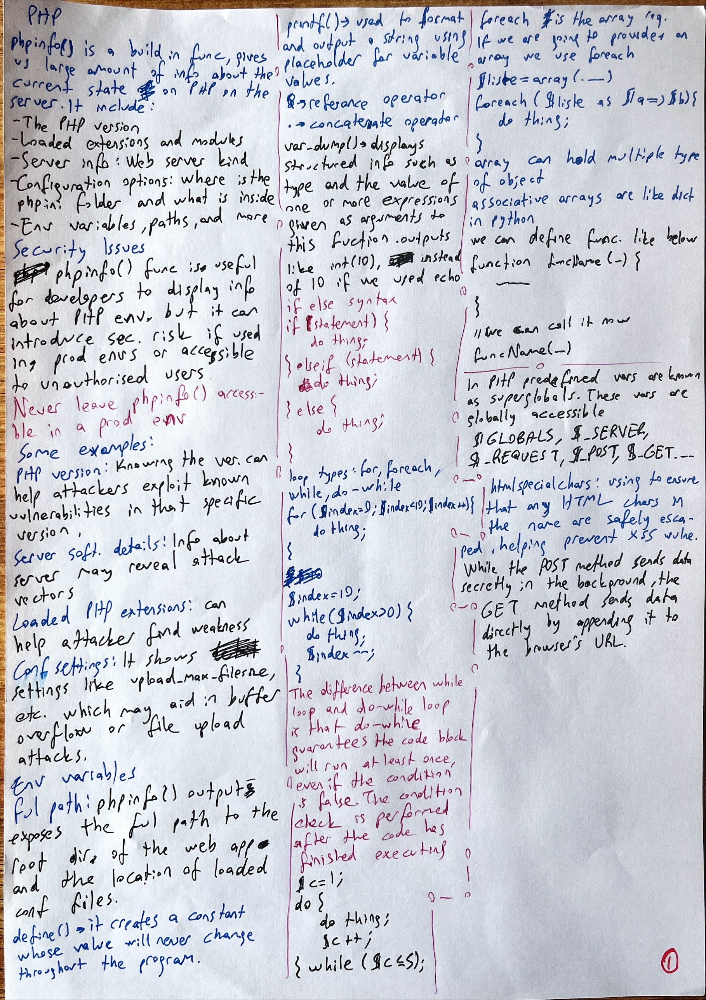
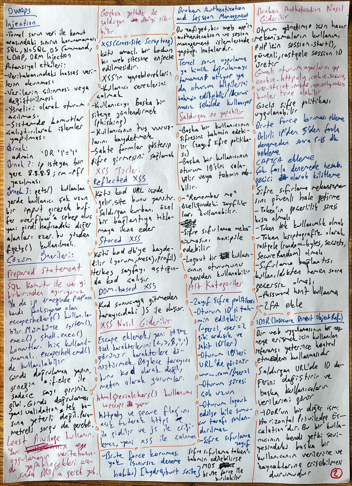
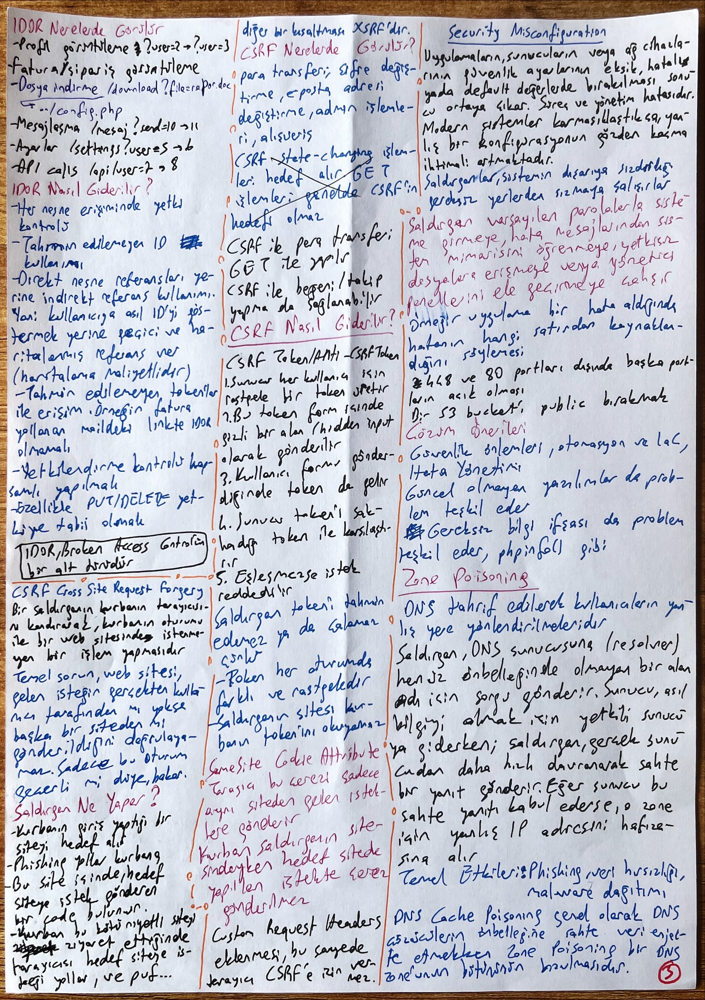
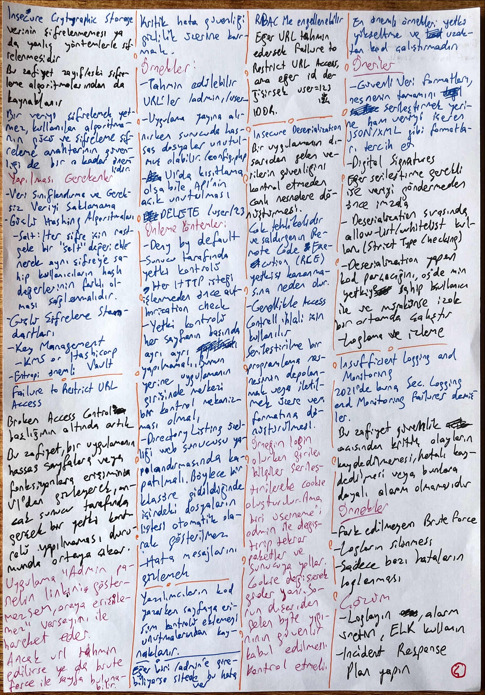
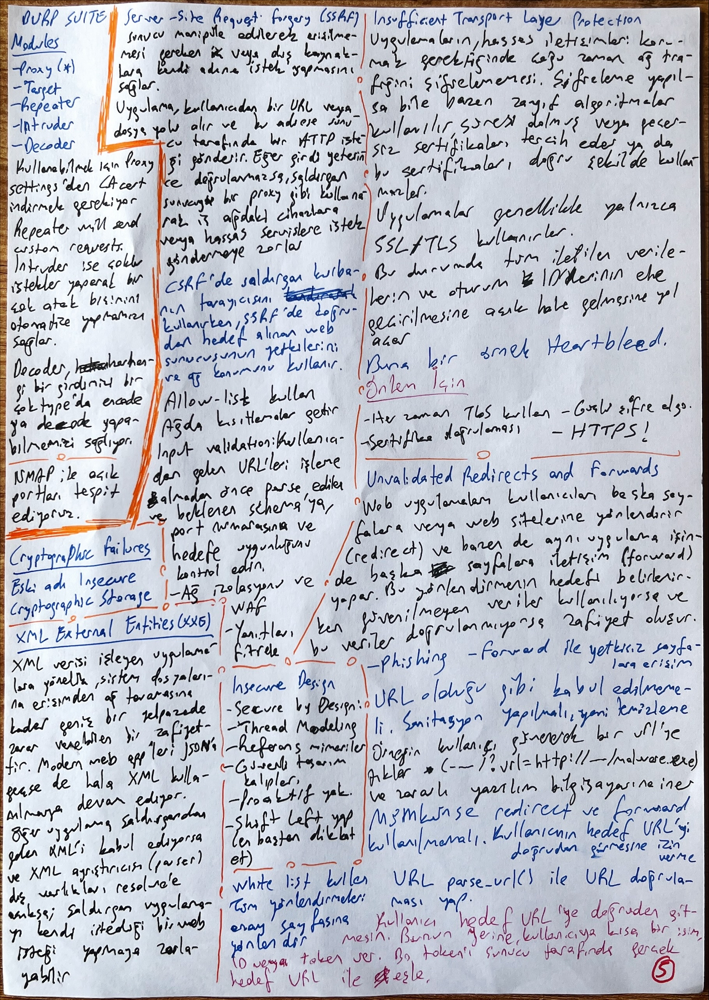
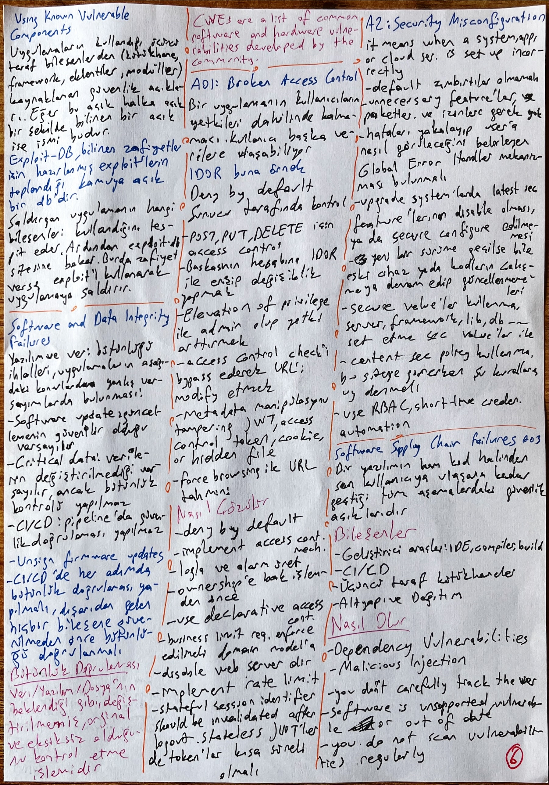
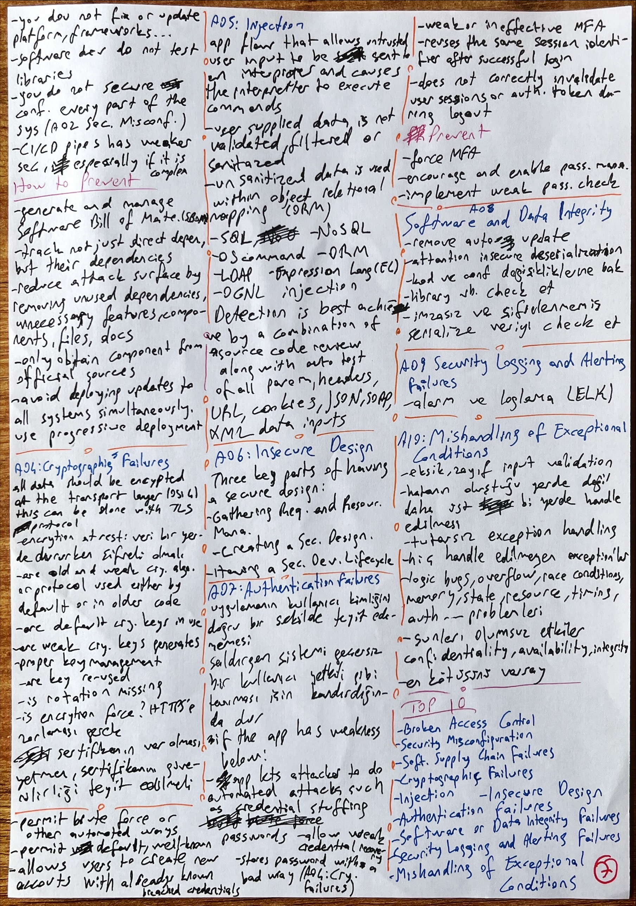
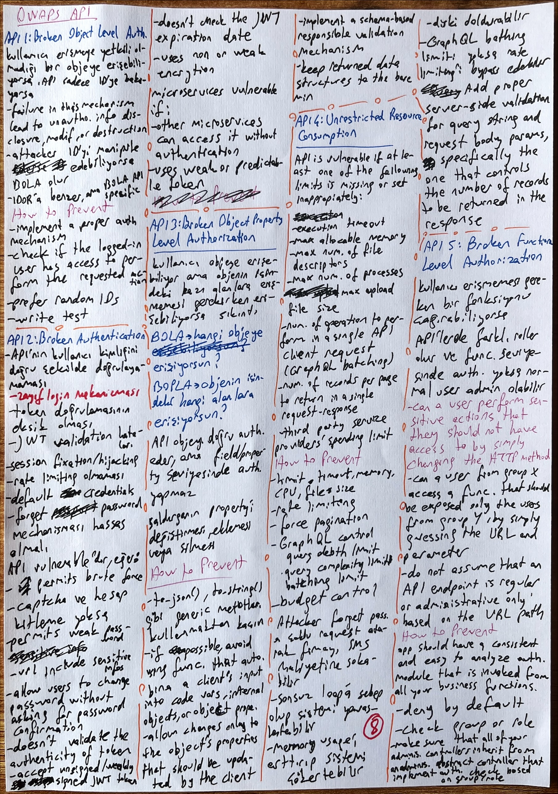
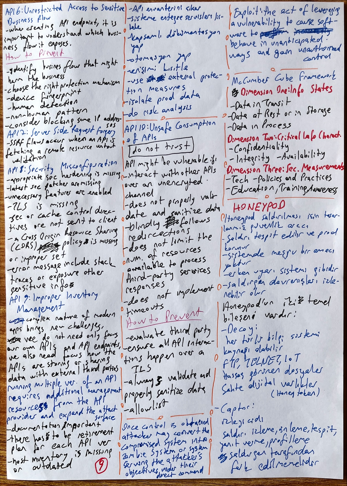
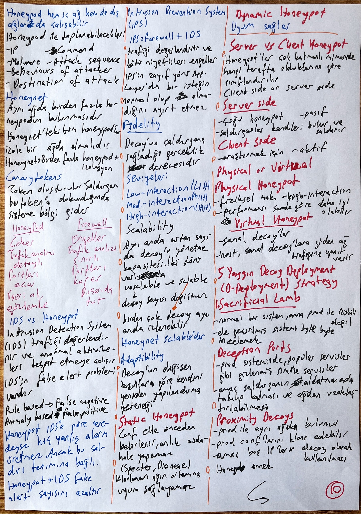
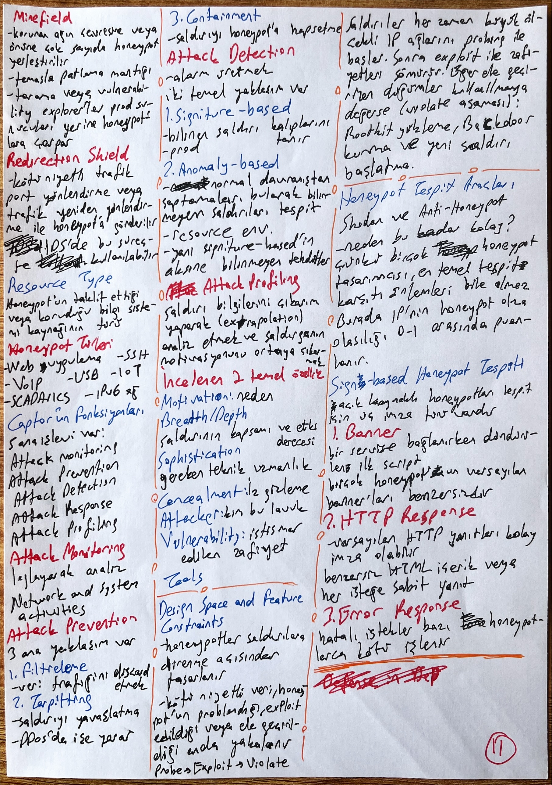
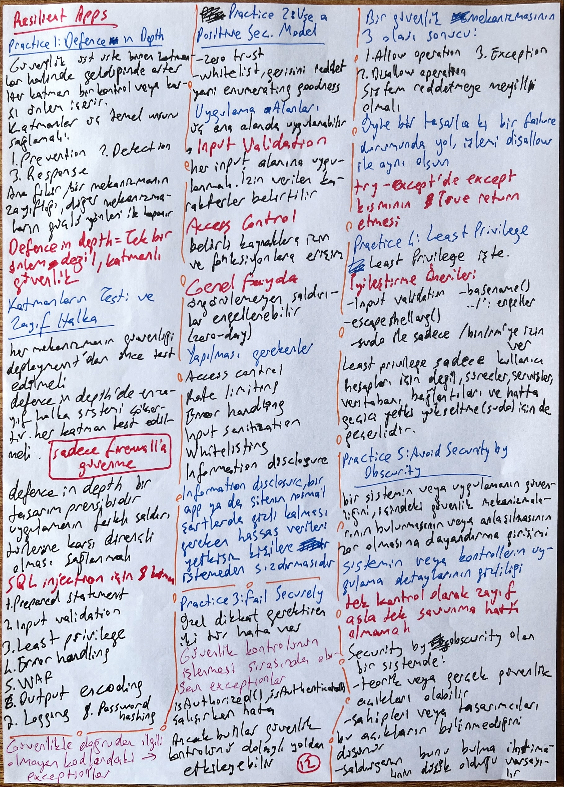
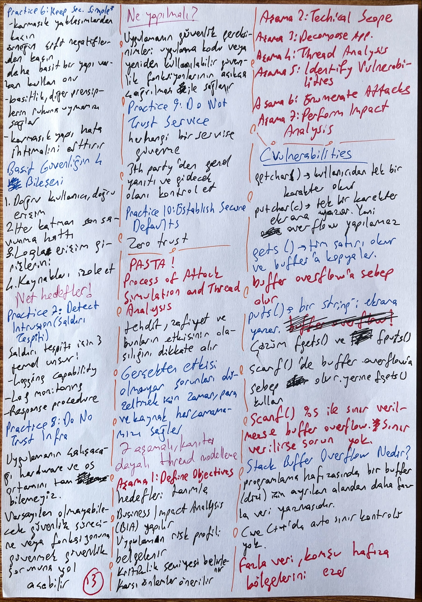
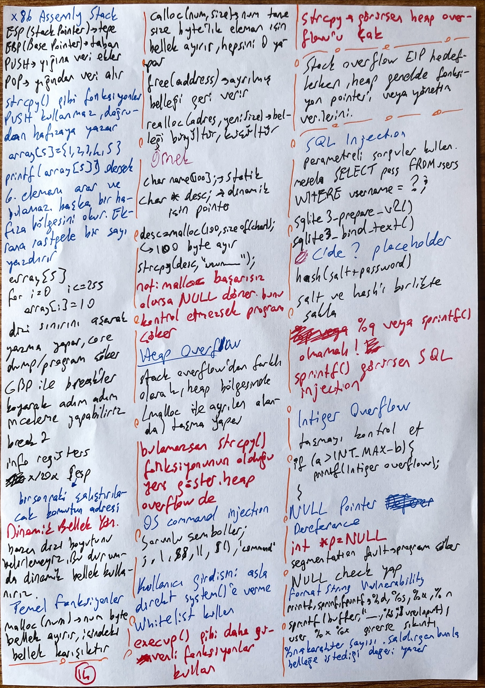
