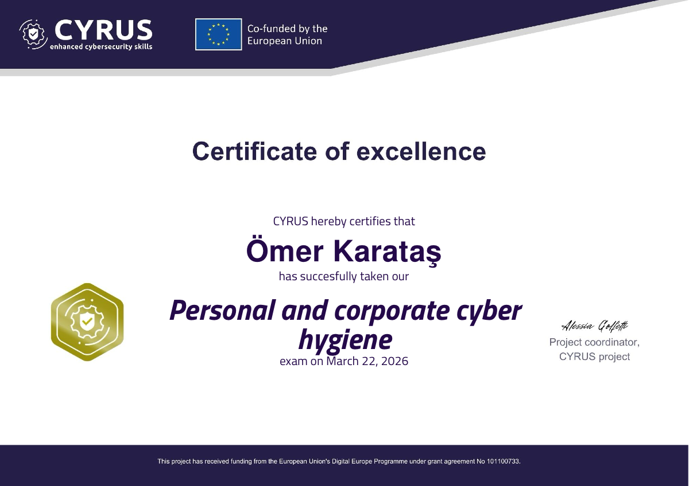
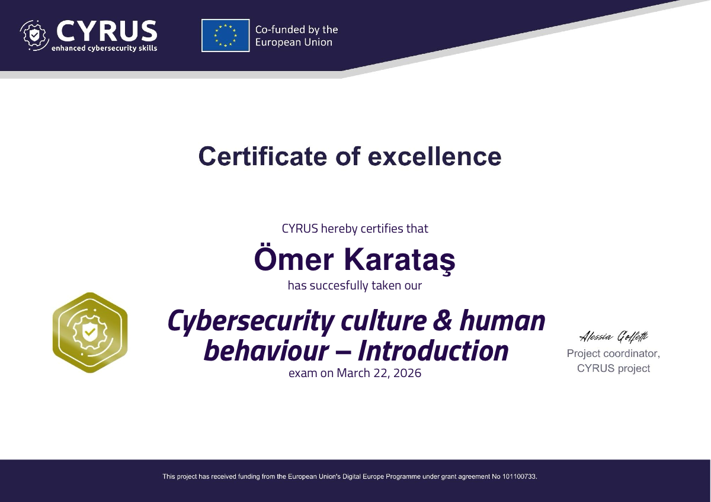
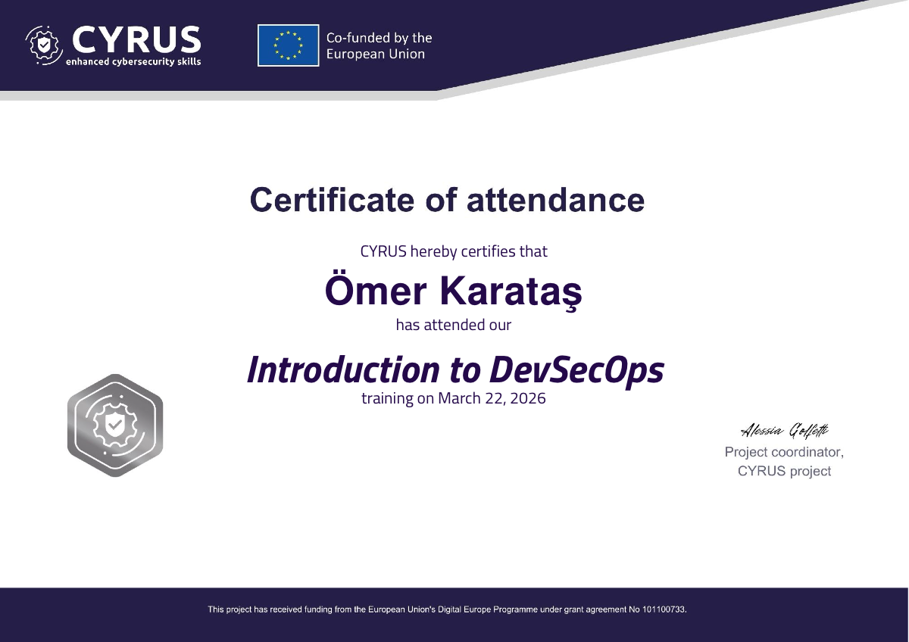
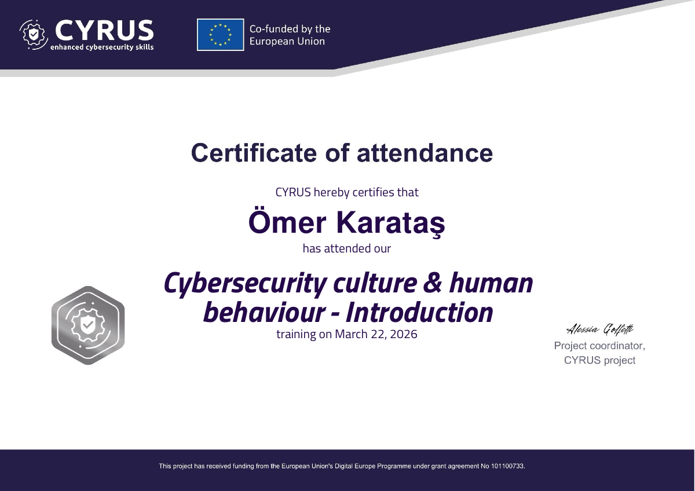
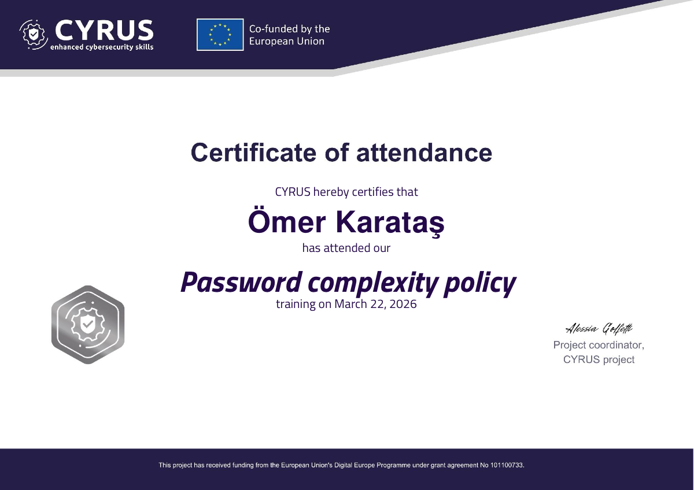
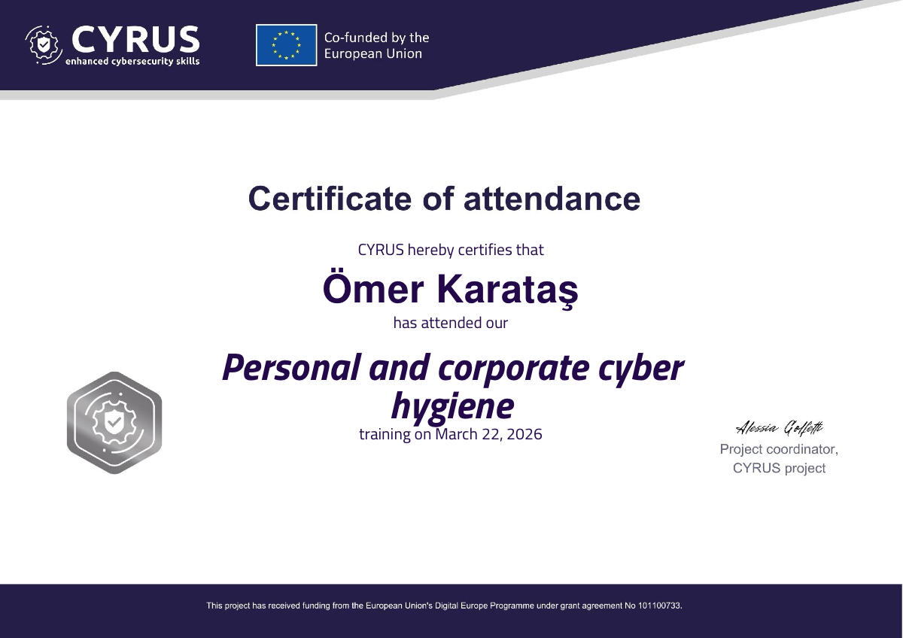

# SEC 509 - Lab 2: Cybersecurity Training & Certifications 🛡️📜

Welcome to the **SEC 509: Secure Coding & Software Security** Lab 2 documentation. This module showcases the official certificates awarded for completing advanced cybersecurity and DevSecOps training under the **CYRUS** (CYbersecurity awareness tRaining for Small and medium-sized enterprises) project, co-funded by the European Union.

---

## 🏆 Certificates of Excellence

Awarded for top-tier performance and achieving excellence in the rigorous post-course knowledge assessments.

### 1. Post-Course Knowledge Assessment
Comprehensive evaluation testing threat modeling, DevSecOps principles, identity governance, and cyber hygiene.

  
👉 [📥 View / Download Official PDF](./assets/omerkaratas-Post-Course-Knowledge-Assessment-Certificate-of-excellence-CYRUS.pdf)

---

### 2. Post-Knowledge Assessment
Advanced knowledge verification evaluating practical vulnerability mitigation, authentication enforcement, and organizational security posture.

  
👉 [📥 View / Download Official PDF](./assets/omerkaratas-Post-Knowledge-Assessment-Certificate-of-excellence-CYRUS.pdf)

---

## 🎓 Certificates of Attendance & Module Completion

### 3. Introduction to DevSecOps
Focuses on integrating security into continuous delivery (CI/CD) pipelines, shifting left, automated compliance checks, and shared responsibility culture.

  
👉 [📥 View / Download Official PDF](./assets/omerkaratas-Introduction-to-DevSecOps-Certificate-of-attendance-CYRUS.pdf)

---

### 4. Cybersecurity Culture & Human Behaviour
Explores psychological factors in digital defense, social engineering vulnerabilities, phishing defense mechanisms, and establishing security-first organizational cultures.

  
👉 [📥 View / Download Official PDF](./assets/omerkaratas-Cybersecurity-culture-amp-human-behaviour-Introduction-Certificate-of-attendance-CYRUS.pdf)

---

### 5. Password Complexity Policy
Hands-on mastery of Pluggable Authentication Modules (PAM), password entropy requirements, rotation policies, and preventing credential-stuffing attacks.

  
👉 [📥 View / Download Official PDF](./assets/omerkaratas-Password-complexity-policy-Certificate-of-attendance-CYRUS.pdf)

---

### 6. Personal and Corporate Cyber Hygiene
Foundational defense strategies for digital workspaces: patch management, network segmentation, multi-factor authentication (MFA), and secure remote access.

  
👉 [📥 View / Download Official PDF](./assets/omerkaratas-Personal-and-corporate-cyber-hygiene-Certificate-of-attendance-CYRUS.pdf)

---

## 🏛️ Training Platform Details
* **Provider:** [CYRUS Project (cyrus-project.eu)](https://cyrus-project.eu/)
* **Initiative:** European Union Digital Europe Programme
* **Participant:** Ömer Karataş
* **Course Context:** Applied Cybersecurity & Software Security (SEC 509)

